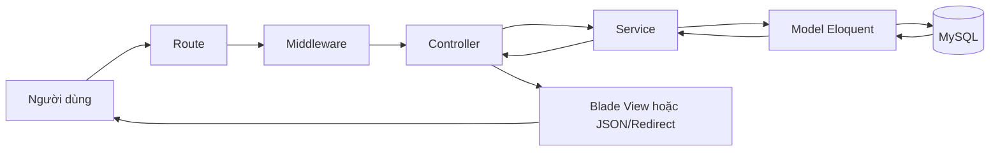
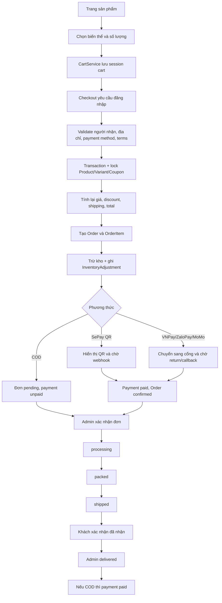
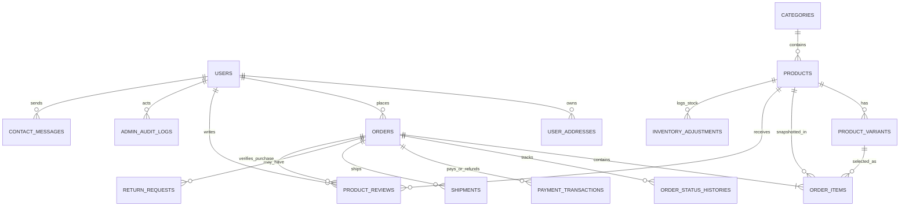
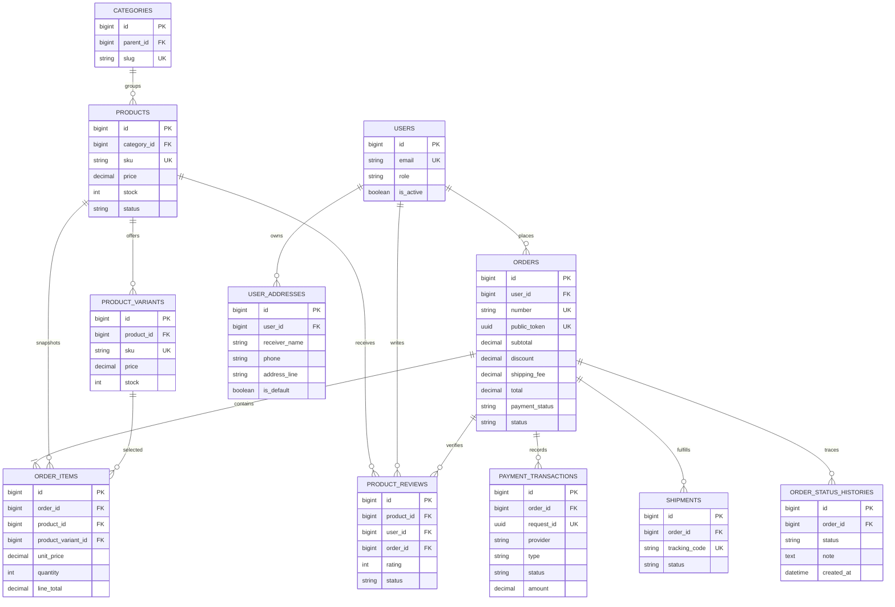

# Kịch bản học và bảo vệ Lab 08 - Pawora

> Tài liệu học nội bộ cho bốn thành viên. Nội dung được đối chiếu với source code tại commit `93fcef6`, ngày 31/08/2026. Không chép khóa bí mật từ `.env` vào tài liệu này.

## 0. Kết quả kiểm tra source (chạy lại ngày 26/09/2026 trên XAMPP)

| Kiểm tra | Kết quả | Ý nghĩa khi bảo vệ |
|---|---|---|
| `php artisan route:list` | 129 route | Chứng minh đủ route cửa hàng, tài khoản, thanh toán, webhook và Admin. |
| `php artisan migrate:status` | 27/28 migration `Ran` trên MariaDB 10.4.32 của XAMPP | Database đúng với code. |
| `php artisan test` | 171 test, 1.800 assertion, 0 lỗi | Nói đúng con số này; chi tiết trong `docs/testing-report.md`. |
| `npm run build`, `composer validate --strict` | Pass | Frontend build được, `composer.json` hợp lệ. |
| README | README Pawora đầy đủ cài đặt, tài khoản demo, COD, QR chuyển khoản, test, export SQL | Đạt mục 27-28 Lab 8. |
| File SQL | `database/export/pawora_demo.sql`, export lại 26/09/2026, đủ 27 bảng/28 migration; import thử khớp schema | Là file SQL duy nhất để nộp. Thêm migration mới thì phải export lại. |
| Thanh toán QR | QR Demo đã gỡ (26/09/2026). QR là chuyển khoản SePay/VietQR, cần `SEPAY_BANK` + `SEPAY_ACCOUNT_NUMBER` trong `.env` | Xác nhận bằng webhook SePay hoặc Admin bấm “Xác nhận đã nhận thanh toán”. Máy chưa cấu hình SePay chỉ chạy COD. |

Bản online cho giảng viên: https://petshopnew-production.up.railway.app (Railway, MySQL riêng, GHN sandbox, COD/VNPay/ZaloPay/MoMo sandbox). Nếu mạng lớp ổn có thể demo trên link này; XAMPP là phương án dự phòng.

Lưu ý trên máy của nhóm: phải bật Apache và MySQL trong XAMPP Control Panel trước khi chạy. Nếu Windows có sẵn biến môi trường `DB_PASSWORD` của project khác, chạy `$env:DB_PASSWORD = $null` trong PowerShell trước các lệnh `php artisan`.

## 1. Phân công chính thức

Nhóm chia việc theo đúng chuỗi 11 bước giảng viên yêu cầu:

```text
PHÂN TÍCH NGHIỆP VỤ → THIẾT KẾ DATABASE → LARAVEL MVC → GIAO DIỆN → SẢN PHẨM → GIỎ HÀNG
→ CHECKOUT → THANH TOÁN → ĐƠN HÀNG → ADMIN → KIỂM THỬ
```

| # | Bước | Thành viên | Sản phẩm cần có khi bảo vệ |
|---|---|---|---|
| 1 | Phân tích nghiệp vụ | Nguyễn Ngọc Minh Thu | Tác nhân Khách/Admin/Staff, use case, luồng mua hàng chính, trạng thái đơn và thanh toán |
| 2 | Thiết kế Database | Nguyễn Ngọc Minh Thu | ERD, giải thích PK/FK/unique, 28 migration, file `database/export/pawora_demo.sql` |
| 3 | Laravel MVC | Nguyễn Ngọc Minh Thu | Luồng Route → Middleware → Controller → Service → Model → View, ví dụ thật trong source |
| 4 | Giao diện | Trần Thị Mỹ Ngân | Layout chung, brand, toàn bộ trang phía khách (trang chủ, sản phẩm, giỏ, checkout, xác nhận, đơn hàng, tài khoản), responsive |
| 5 | Sản phẩm | Nguyễn Tiến Đạt | Catalog, tìm kiếm/lọc/sắp xếp/phân trang, chi tiết, biến thể, đánh giá (backend) |
| 6 | Giỏ hàng | Nguyễn Tiến Đạt | `CartService`, thêm/sửa/xóa, session cart, kiểm tồn kho (backend) |
| 7 | Checkout | Nguyễn Tiến Đạt | Validate form, phí vận chuyển, **mã giảm giá**, transaction, `lockForUpdate`, trừ tồn kho |
| 8 | Thanh toán | Nguyễn Tiến Đạt | COD, QR chuyển khoản SePay (trang QR đúng số tiền/mã đơn, webhook kiểm API key + số tiền, Admin xác nhận đã thanh toán) và VNPay sandbox (thẻ test NCB) |
| 9 | Đơn hàng | Nguyễn Tiến Đạt | Order/OrderItem, trạng thái đơn và thanh toán, quyền xem đơn, hủy đơn |
| 10 | Admin | Lê Ngọc Bình Minh | Toàn bộ Admin, **kể cả giao diện Admin**: dashboard, sản phẩm/danh mục, tồn kho, mã giảm giá, người dùng, đơn hàng/vận chuyển, phân quyền |
| 11 | Kiểm thử | Trần Thị Mỹ Ngân | `php artisan test`, bảng test case đúng/sai, visual QA, README, cài máy sạch |

| Thành viên | Các bước | Không phụ trách |
|---|---|---|
| Nguyễn Ngọc Minh Thu | 1 · 2 · 3 | Code chức năng cụ thể, Admin |
| Trần Thị Mỹ Ngân | 4 · 11 | Logic backend, Admin |
| Nguyễn Tiến Đạt | 5 · 6 · 7 · 8 · 9 (chỉ backend) | Mọi giao diện Blade/CSS, Admin |
| Lê Ngọc Bình Minh | 10 (cả giao diện lẫn xử lý) | Chức năng phía khách |

Ghi chú:

- Đăng nhập, hồ sơ, địa chỉ và liên hệ không nằm trong 11 bước. Nhóm quy ước phần backend do Đạt trả lời, giao diện form do Ngân trả lời.
- Nhóm giữ nguyên code các tích hợp nâng cao (VNPay, ZaloPay, MoMo, webhook hoàn tiền, GHN, chat tự động, 2FA, audit log) nhưng **không đưa vào phần bảo vệ chính**. Khi bị hỏi thì trả lời: “Có sẵn trong hệ thống, nhóm em chỉ trình bày luồng cơ bản.”

Bản đồ tài liệu cần học:

| Thành viên | Phần cần học trong tài liệu này |
|---|---|
| Minh Thu | Phần I (mục 2-8) và mục 9 “Tờ học nhanh của Minh Thu”; mục E “Database cần học” trong Phần II và Phần III |
| Tiến Đạt | Phần II (checkout, thanh toán, đơn hàng) và Phần III (sản phẩm, giỏ hàng); phần backend đăng nhập/tài khoản trong Phần V |
| Bình Minh | Phần IV |
| Mỹ Ngân | Phần V (giao diện, kiểm thử), mục 9-11 của Phần VI |

# PHẦN I - PHÂN TÍCH NGHIỆP VỤ, DATABASE, LARAVEL MVC (NGUYỄN NGỌC MINH THU)

> Minh Thu trình bày các mục 2-6 (bước 1-3). Cả nhóm vẫn phải nắm mục 7 để trả lời thống nhất.

## 2. Pawora giải quyết bài toán gì?

Pawora là website thương mại điện tử bán phụ kiện cho chó và mèo. Website hỗ trợ khách khám phá sản phẩm theo danh mục và loại thú cưng, chọn biến thể, quản lý giỏ, đặt hàng, thanh toán, theo dõi đơn, đổi trả và đánh giá sau khi nhận hàng. Phía vận hành có Admin Dashboard, quản lý catalog, tồn kho, khách hàng, đơn hàng, vận chuyển, thanh toán, hoàn tiền, đánh giá, liên hệ, chat và nhật ký quản trị.

Điểm cần nói rõ: đây không còn là website mẫu chỉ có CRUD. Hệ thống đã có nghiệp vụ giá tại thời điểm mua, khóa tồn kho, trạng thái đơn hàng, trạng thái thanh toán, callback cổng thanh toán, phân quyền Admin/Staff và audit log.

## 3. Kiến trúc Laravel MVC trong Pawora

| Lớp | Vai trò trong Pawora | Ví dụ thật |
|---|---|---|
| Route | Nhận URL, HTTP method, gắn middleware và chuyển request | `routes/web.php:36-165`, `routes/api.php:21` |
| Middleware | Xác thực, kiểm tra Admin, 2FA, permission, throttle | `routes/web.php:43-50`, `routes/web.php:107-158`, `app/Http/Middleware/EnsurePermission.php:10-14` |
| Controller | Điều phối request, validate, gọi service/model và trả response | `CheckoutController::store()` tại `app/Http/Controllers/CheckoutController.php:110` |
| Service | Đóng gói nghiệp vụ dùng lại hoặc tích hợp ngoài | `CartService`, `InventoryService`, `ShippingCalculator`, các Gateway, `RefundService` |
| Model | Đại diện bảng, quan hệ và quy tắc trạng thái | `Order` tại `app/Models/Order.php:8-175` |
| Database | Lưu dữ liệu lâu dài, ràng buộc FK/unique/index | `database/migrations/2026_08_19_000001_create_pawora_commerce_tables.php` |
| View | Blade render giao diện và form | `resources/views/store/checkout.blade.php`, `resources/views/admin/dashboard.blade.php` |
| JavaScript/CSS | Tương tác AJAX, animation, responsive | `resources/js/app.js`, `resources/css/app.css` |
| Test | Xác minh hành vi và chống hồi quy | `tests/Feature/CommerceTest.php`, `OrderWorkflowTest.php`, `AdminProductionReadinessTest.php` |

## 4. Luồng tổng thể của một request



Ví dụ đặt hàng: form `store.checkout` POST tới `checkout.store`; route yêu cầu `auth` và throttle; `CheckoutController::store()` validate; `CartService` chuẩn hóa giỏ; transaction khóa Product/Variant; `InventoryService` trừ kho; Eloquent ghi `orders`, `order_items`, `inventory_adjustments`, `order_status_histories`; cuối cùng chuyển sang QR/cổng thanh toán hoặc trang xác nhận.

## 5. Luồng mua hàng hoàn chỉnh



## 6. Các bảng database quan trọng



| Bảng | Vai trò và khóa đáng nhớ |
|---|---|
| `users` | PK `id`; email unique; có `role`, `is_active`; quan hệ tới orders, addresses, reviews. |
| `categories` | PK `id`; `parent_id` tự tham chiếu; `slug` unique; một danh mục có nhiều sản phẩm. |
| `products` | PK `id`; FK `category_id`; `slug`, `sku` unique; giữ giá cơ sở, tồn tổng, trạng thái. |
| `product_variants` | PK `id`; FK `product_id`; `sku` unique; giá/tồn theo size-color. |
| `orders` | PK `id`; `number`, `public_token` unique; FK `user_id`; giữ thông tin giao hàng, các tổng tiền và hai loại trạng thái. |
| `order_items` | PK `id`; FK `order_id`, `product_id`, `product_variant_id`; chụp tên, SKU, giá, số lượng, thành tiền lúc mua. |
| `order_status_histories` | PK `id`; FK `order_id`, `user_id`; ghi trạng thái trước/sau và ghi chú. |
| `payment_transactions` | PK `id`; FK `order_id`; `request_id` unique; unique cặp provider/transaction; lưu request/response callback. |
| `shipments` | PK `id`; FK `order_id`; tracking code unique; trạng thái vận chuyển và mốc thời gian. |
| `inventory_adjustments` | PK `id`; FK product/variant/user; polymorphic reference; sổ cái trước-thay đổi-sau. |
| `product_reviews` | PK `id`; FK product/user/order; unique product-user; xác minh người mua đã nhận hàng. |
| `admin_audit_logs` | PK `id`; FK actor; polymorphic auditable; ghi old/new values, IP và user agent. |

## 7. Những khái niệm phải trả lời thống nhất

### Authentication và Authorization

- Authentication trả lời “người dùng là ai?”, ví dụ `Auth::attempt()` trong `AuthController.php:26-41` và middleware `auth`.
- Authorization trả lời “người đó được làm gì?”, ví dụ `EnsurePermission.php:10-14`, `User::hasPermission()` tại `User.php:107-112` và kiểm tra chủ sở hữu đơn tại `AccountController.php:103-109`.

### Validation

Validation chặn dữ liệu sai trước nghiệp vụ. Ví dụ checkout kiểm tra tên, email, điện thoại, tỉnh, phường, địa chỉ, phương thức và điều khoản tại `CheckoutController.php:113-128`. Validation phía trình duyệt chỉ hỗ trợ trải nghiệm; backend mới là nguồn tin cậy.

### CSRF

Các form POST/PATCH/DELETE có `@csrf`; Laravel so token session để chống website khác gửi request thay người dùng. CSRF khác chữ ký webhook: webhook không dùng session người dùng nên phải kiểm tra secret/HMAC của nhà cung cấp.

### Transaction

Transaction đảm bảo một nhóm ghi dữ liệu cùng thành công hoặc cùng rollback. Checkout dùng `DB::transaction()` tại `CheckoutController.php:146-195`; hủy/hoàn tiền và điều chỉnh tồn kho cũng dùng transaction.

### `lockForUpdate`

`lockForUpdate()` khóa bản ghi trong transaction để hai request không cùng đọc một lượng tồn rồi cùng bán vượt kho. Checkout khóa Product/Variant tại dòng 149-153 và Coupon tại dòng 176.

### Trạng thái đơn và trạng thái thanh toán

- `orders.status`: tiến trình thực hiện đơn: pending, confirmed, processing, packed, shipped, delivered, cancelled.
- `orders.payment_status`: tình trạng tiền: unpaid, pending, paid, failed, refund_pending, refunded.
- Một đơn COD có thể `status=confirmed` nhưng `payment_status=unpaid`; chỉ ghi paid khi giao hoàn tất theo `AdminController.php:634-637`.

## 8. Bàn giao giữa bốn thành viên

| Người giao | Người nhận | Hợp đồng dữ liệu |
|---|---|---|
| Minh Thu | Cả nhóm | Use case, ERD, danh sách bảng/cột/khóa và sơ đồ MVC. Mọi người dùng chung tên bảng, tên trạng thái và thuật ngữ. |
| Tiến Đạt | Mỹ Ngân | Với mỗi trang: route, tên trường form (ví dụ `quantity`, `variant_id`, `coupon_code`, `payment_method`), biến controller truyền sang view và định dạng JSON của các request AJAX. Ngân chỉ hiển thị, không tự tính giá hoặc tồn kho. |
| Mỹ Ngân | Tiến Đạt | Trang Blade đúng `@csrf`/`@method`, hiển thị lỗi validation và thông báo flash. |
| Tiến Đạt | Bình Minh | Order có `status`, `payment_status`, totals, items, histories, payments; Coupon có `used_count`. Admin chỉ chuyển trạng thái theo rule của Model. |
| Bình Minh | Tiến Đạt | Product/Category/Variant/Coupon do Admin tạo; storefront chỉ đọc bản ghi active. |
| Ba thành viên | Mỹ Ngân | Test case, dữ liệu demo, file code trọng tâm, lỗi đã biết và cách tái hiện. |
| Mỹ Ngân | Cả nhóm | Tài khoản demo, README, checklist, ảnh kết quả test và lịch demo. |

## 9. Tờ học nhanh của Minh Thu (bước 1-3)

### Bài nói mở đầu 3-5 phút

“Em là Nguyễn Ngọc Minh Thu, phụ trách ba bước đầu: phân tích nghiệp vụ, thiết kế database và kiến trúc Laravel MVC.

Về nghiệp vụ, Pawora là website bán phụ kiện cho chó và mèo. Hệ thống có ba tác nhân. Khách xem sản phẩm, chọn biến thể, thêm vào giỏ, đặt hàng, thanh toán và theo dõi đơn. Admin quản lý sản phẩm, tồn kho, mã giảm giá, đơn hàng và người dùng. Staff là nhân viên chỉ có một phần quyền của Admin. Luồng chính là: sản phẩm → giỏ hàng → checkout → thanh toán → đơn hàng → Admin xử lý → giao hàng.

Về database, trung tâm là bảng `orders`. Một user có nhiều order; một order có nhiều `order_items`; mỗi item trỏ tới product và variant. Product thuộc category và có nhiều variant theo size/màu. Bên cạnh đó có bảng `coupons` cho mã giảm giá, `payment_transactions` cho giao dịch, `inventory_adjustments` làm sổ kho và `order_status_histories` ghi lịch sử trạng thái. Các cột như email, slug, SKU, mã đơn đều có unique để chống trùng.

Về kiến trúc, project dùng Laravel 12 theo mô hình MVC. Một request đi qua Route, Middleware, Controller, Service, Model rồi trả về Blade View. Ví dụ, mở trang sản phẩm thì route `/san-pham` gọi `StoreController::index()`, controller dùng Model `Product` để query MySQL rồi trả view `store.products`.”

### 10 ý bắt buộc nhớ

1. Ba tác nhân: Khách (customer), Admin, Staff. Staff có ít quyền hơn Admin.
2. Luồng nghiệp vụ chính: sản phẩm → giỏ → checkout → thanh toán → đơn hàng → Admin → giao hàng.
3. Đơn có hai trạng thái riêng: `status` (tiến trình xử lý hàng) và `payment_status` (tình trạng tiền).
4. Bảng trung tâm là `orders`; `order_items` lưu giá lúc mua (snapshot) nên đổi giá sau này không làm sai đơn cũ.
5. Product 1-n Variant; Category 1-n Product; User 1-n Order; Order 1-n OrderItem.
6. Giỏ hàng **không có bảng** riêng; nó nằm trong session.
7. Database được tạo bằng migration (28 file trong `database/migrations`) và có bản export `database/export/pawora_demo.sql`.
8. Unique quan trọng: `users.email`, `products.slug`, `products.sku`, `product_variants.sku`, `orders.number`, `coupons.code`.
9. MVC: Route nhận URL → Middleware kiểm tra (đăng nhập, quyền) → Controller điều phối → Model đọc/ghi DB → View hiển thị.
10. Service (`CartService`, `CouponService`, `InventoryService`...) là nơi gom nghiệp vụ dùng lại, giúp controller gọn.

### File/bảng/lệnh trọng tâm

- File: `routes/web.php`, `app/Http/Controllers/StoreController.php`, `app/Models/Product.php`, `app/Models/Order.php`, `database/migrations/`, `database/export/pawora_demo.sql`, `resources/views/store/products.blade.php`.
- Bảng: users, categories, products, product_variants, orders, order_items, coupons, payment_transactions, inventory_adjustments.
- Lệnh: `php artisan route:list`, `php artisan migrate:status`, `php artisan migrate --seed`.

### 10 câu dễ bị hỏi nhất

1. Hệ thống có những tác nhân nào, mỗi tác nhân làm được gì?
2. Vẽ lại ERD và chỉ ra bảng trung tâm.
3. Vì sao tách `product_variants` khỏi `products`?
4. Vì sao `order_items` phải lưu giá thay vì lấy giá từ `products`?
5. Giỏ hàng lưu ở đâu? Vì sao không có bảng `carts`?
6. Migration là gì? Khác gì so với tạo bảng bằng phpMyAdmin?
7. Một request từ trình duyệt đi qua những lớp nào trong Laravel?
8. Middleware dùng để làm gì trong Pawora?
9. Model, Controller, View khác nhau thế nào? Cho một ví dụ thật.
10. `status` và `payment_status` của đơn khác nhau thế nào?

### Tuyệt đối không trả lời sai

- Không nói giỏ hàng nằm trong bảng `carts`.
- Không nói Controller truy vấn SQL thuần; project dùng Eloquent Model.
- Không nói COD được tính là đã thanh toán ngay khi đặt hàng.
- Không nhận phần code chi tiết checkout/thanh toán hoặc Admin; chuyển cho Đạt hoặc Bình Minh.

# PHẦN II - CHECKOUT, THANH TOÁN, ĐƠN HÀNG (NGUYỄN TIẾN ĐẠT)

## A. Phạm vi phụ trách

Đạt phụ trách backend của năm bước: **Sản phẩm, Giỏ hàng** (xem Phần III), **Checkout, Thanh toán, Đơn hàng** (phần này). Phần này tính từ lúc người dùng mở checkout đến khi đơn hàng, tiền và tồn kho đạt trạng thái nhất quán: địa chỉ, **mã giảm giá**, phí vận chuyển, tổng tiền, tạo Order/OrderItem, trừ tồn kho, COD, QR chuyển khoản SePay, trạng thái tiền, lịch sử đơn, quyền xem đơn và hủy đơn.

Phạm vi bảo vệ chính gồm **COD, QR chuyển khoản SePay và VNPay sandbox**. Các cổng ZaloPay, MoMo và luồng hoàn tiền qua webhook vẫn còn trong code và được mô tả ở mục C-D để tham khảo; khi bị hỏi, Đạt trả lời ở mức “có sẵn, dùng chung mô hình kiểm tra chữ ký + số tiền”.

Đạt **không làm giao diện**: các trang checkout, xác nhận, trang QR chuyển khoản và đơn hàng do Ngân làm. Đạt không phụ trách CRUD Admin. Điểm giao với Ngân là tên trường form, biến truyền sang view và JSON AJAX; điểm giao với Bình Minh là `Order::ADMIN_TRANSITIONS`, coupon và payment state; điểm giao với Minh Thu là ERD và tên trạng thái.

## B. Bài nói mở đầu 3-5 phút

“Em là Nguyễn Tiến Đạt, phụ trách checkout, thanh toán và đơn hàng. Điểm chính trong phần của em là server không tin dữ liệu giá từ trình duyệt. Khi khách gửi form checkout, hệ thống chỉ nhận các thông tin cần thiết như người nhận, địa chỉ, coupon và phương thức thanh toán. Trong transaction, hệ thống đọc lại Product và ProductVariant từ database, khóa các bản ghi bằng `lockForUpdate`, kiểm tra trạng thái và tồn kho, rồi lấy giá thật từ database để tính subtotal.

Sau đó hệ thống kiểm tra lại coupon, tính phí vận chuyển, tạo Order, tạo từng OrderItem và trừ tồn kho. OrderItem lưu `unit_price` và `line_total` để lịch sử mua hàng không thay đổi nếu giá sản phẩm sau này được cập nhật. Toàn bộ khối này nằm trong một database transaction, nên nếu tạo item hoặc trừ tồn kho lỗi thì Order cũng rollback.

Với COD, đơn được tạo ở trạng thái chờ xử lý và chưa thanh toán. Với chuyển khoản QR, hệ thống hiển thị mã VietQR chứa đúng số tiền và nội dung là mã đơn. Tiền về thì webhook SePay gọi vào, hệ thống kiểm tra API key, mã đơn và số tiền, webhook lặp không cập nhật lần hai, rồi mới đổi `payment_status` thành `paid`. Khi demo trên lớp không có tiền thật, Admin bấm “Xác nhận đã nhận thanh toán”, thao tác được ghi lịch sử và audit. Với VNPay, khách được chuyển sang cổng sandbox, thanh toán bằng thẻ test NCB; khi trình duyệt quay về, Pawora kiểm chữ ký HMAC-SHA512 và số tiền rồi mới ghi `paid`. ZaloPay và MoMo dùng cùng nguyên tắc; nhóm giữ trong code nhưng không demo. OnePay đã được gỡ khỏi dự án vì sandbox dừng ở bước 3D Secure.

Em phân biệt rõ trạng thái đơn và trạng thái thanh toán. Trạng thái đơn mô tả quá trình xử lý hàng; trạng thái thanh toán mô tả dòng tiền. Hai trạng thái liên quan nhưng không đồng nhất. Ví dụ COD có thể đã xác nhận đơn nhưng chưa thu tiền. Khi khách xác nhận nhận hàng và Admin hoàn tất giao hàng, hệ thống mới ghi COD đã thanh toán.

Phần bảo mật của em kiểm tra chủ sở hữu hoặc token công khai khi xem đơn, không cho truy cập đơn của người khác. Hủy đơn sẽ hoàn tồn kho, còn đơn đã trả tiền sẽ tạo yêu cầu hoàn tiền có khóa idempotency. Các callback hoàn tiền cũng khóa bản ghi, đối chiếu số tiền và nếu đã thành công thì trả lại kết quả cũ thay vì cộng tiền hai lần.”

## C. Luồng xử lý chi tiết

| Chức năng | Luồng chính xác |
|---|---|
| Mở checkout | GET `/thanh-toan` → middleware `auth` → `CheckoutController::create()` → `CartService::details()` → nếu rỗng quay về cart → đọc địa chỉ/coupon/config → view `store.checkout`. |
| Báo giá vận chuyển | GET `/phi-van-chuyen` → `auth`, throttle → validate tỉnh/district/ward/coupon → chi tiết giỏ server → `ShippingCalculator::quote()` → JSON fee/zone/estimate/discount/total. |
| Kiểm tra coupon | GET `/ma-uu-dai/kiem-tra` → validate code → `Coupon::isValidFor()` và `discountFor()` → JSON. Khi đặt hàng, coupon bị kiểm tra lại trong transaction. |
| Tạo đơn | POST `/thanh-toan` → `auth`, throttle → validate → kiểm tra gateway enabled → lấy line giỏ → transaction → lock Product/Variant/Coupon → lấy lại giá → tính tổng → tạo Order/Items → `InventoryService::deductForOrder()` → history → tăng coupon usage → commit → xóa cart → redirect. |
| COD | `payment_method=cod`; checkout đặt payment `unpaid`, order `pending`; Admin xử lý; khi shipment delivered sau xác nhận nhận hàng thì payment thành `paid`. |
| QR SePay | Checkout redirect `/thanh-toan/sepay/{order}?token={public_token}` → kiểm tra quyền/token và method → `SepayGateway::qrUrl()` → webhook `/api/webhooks/sepay` kiểm tra Authorization, mã đơn, số tiền, trạng thái đã paid → cập nhật Order và PaymentTransaction. |
| VNPay | `VnPayGateway::paymentUrl()` tạo tham số + HMAC; return/IPN tìm order, kiểm tra HMAC và amount; `updateOrCreate` giao dịch; paid thì xác nhận order. |
| ZaloPay | `createPayment()` tạo app transaction, MAC và PaymentTransaction; return/callback kiểm tra checksum/MAC, transaction, order, amount rồi paid. |
| MoMo | `createPayment()` tạo request signed; return/IPN kiểm tra signature, orderId, requestId, order-transaction và amount; `applyResult()` không hạ một order đã paid. |
| Xem đơn | GET `/don-hang/{order}` → `CheckoutController::show()` → Admin, owner, last_order session hoặc guest token hợp lệ → load items/histories → `store.order`. |
| Hủy/hoàn | Customer/Admin kiểm tra quyền và state → transaction khóa Order → cancelled, hoàn kho, history → nếu đã paid gọi `RefundService::request()` với idempotency key → callback signed → cập nhật refund và `refunded_amount`. |

## D. Code quan trọng cần học

| Chức năng | File/dòng | Method/khối | Cách giải thích với thầy |
|---|---|---|---|
| Route checkout/payment/order | `routes/web.php:43-63`, `routes/api.php:21` | Route groups | Checkout cần auth; callback có route riêng; webhook SePay ở API. |
| Validate checkout | `app/Http/Controllers/CheckoutController.php:110-143` | `store()` | Chặn dữ liệu thiếu/sai và cổng chưa cấu hình trước khi ghi đơn. |
| Khóa và tính lại giá | `CheckoutController.php:146-182` | transaction, `lockForUpdate` | Giá lấy từ `$variant?->price ?? $product->price`, không lấy từ request. |
| Tạo Order/Item/trừ kho | `CheckoutController.php:183-195` | `Order::create`, `items()->create` | Order, snapshot item, sổ kho và history là một đơn vị nghiệp vụ. |
| Chọn hướng thanh toán | `CheckoutController.php:196-239` | redirect gateway | Mỗi payment method có nhánh riêng sau khi order commit. |
| Quyền xem đơn | `CheckoutController.php:242-256` | `confirmation()`, `show()` | Kiểm tra Admin/owner/session/token; sai trả 403. |
| Sổ kho | `app/Services/InventoryService.php:17-101` | deduct/restore/record | Trừ cả variant và tổng product, ghi before/change/after. |
| State machine Order | `app/Models/Order.php:10-44`, `100-175` | constants và rule | Không nhận state tùy ý; nghiệp vụ quyết định bước hợp lệ. |
| QR SePay | `app/Services/SepayGateway.php:9-29` | `qrUrl`, `validWebhook` | QR chứa amount và order number; webhook so API key bằng `hash_equals`. |
| Webhook SePay | `app/Http/Controllers/SepayController.php:19-38` | `webhook()` | Chỉ tiền vào, đúng mã đơn, đúng amount, chưa paid mới xử lý. |
| VNPay verify | `app/Services/VnPayGateway.php:43-69` | `validSignature()` | Bỏ trường hash, sắp key, HMAC SHA-512 và `hash_equals`. |
| VNPay amount/idempotency | `app/Http/Controllers/VnPayController.php:50-100` | `ipn()`, `record()` | Đã paid trả mã đã xác nhận; transaction được upsert theo provider ID. |
| ZaloPay callback | `app/Http/Controllers/ZaloPayController.php:29-68` | `callback()` | Kiểm MAC, transaction, order và amount trước khi paid. |
| MoMo callback | `app/Http/Controllers/MomoController.php:12-78` | return/ipn/applyResult | Gắn requestId với order và không ghi failed đè lên paid. |
| Refund idempotent | `app/Services/RefundService.php:14-64` | `request()` | UUID v5 từ khóa logic; cùng yêu cầu trả lại giao dịch pending/succeeded. |
| Refund callback | `app/Services/RefundService.php:67-101` | `applyCallback()` | Khóa refund/order; amount phải khớp; succeeded cũ không cộng lại. |

## E. Database cần học

| Bảng | PK/FK và cột trọng tâm | Dữ liệu thay đổi | Vì sao cần |
|---|---|---|---|
| `orders` | PK `id`; FK `user_id`; unique `number`, `public_token`; totals, payment method/status, status, paid/refund fields | Tạo khi checkout; cập nhật bởi payment/order/shipment/refund | Là header và ảnh chụp giao dịch tổng thể. |
| `order_items` | PK `id`; FK order/product/variant; product_name, sku, unit_price, quantity, line_total | Tạo một dòng cho mỗi line giỏ | Lưu snapshot để đổi tên/giá sản phẩm sau này không sửa lịch sử. |
| `order_status_histories` | PK `id`; FK order/user; from/to/note | Thêm khi tạo/chuyển/hủy/xác nhận tiền | Giải thích ai đổi gì và phục vụ timeline. |
| `payment_transactions` | PK `id`; FK order; unique request ID; provider transaction; type/status/amount/payload | Tạo hoặc upsert khi payment/refund | Audit giao dịch, idempotency và đối soát callback. |
| `shipments` | PK `id`; FK order; tracking unique; status/timestamps | Tạo khi confirm; đổi theo vận chuyển | Tách state logistics khỏi state đơn. |
| `inventory_adjustments` | PK `id`; FK product/variant/user; polymorphic reference | Thêm khi bán, hoàn kho, chỉnh tay | Không chỉ giữ số hiện tại mà còn có sổ giải trình. |
| `coupons` | PK `id`; code unique; value/minimum/time/limit/used | `used_count` tăng khi order commit | Chống dùng mã sai điều kiện hoặc vượt lượt. |
| `return_requests` | PK `id`; FK order/user; status/reason/refund amount | Tạo từ khách, cập nhật bởi Admin/refund | Quản lý quy trình đổi trả tách khỏi payment transaction. |

## F. Kịch bản demo trực tiếp

### Demo chính: COD

1. Chuẩn bị customer đang hoạt động, một sản phẩm active còn ít nhất 3 sản phẩm và ghi lại stock ban đầu.
2. Thêm hai sản phẩm hoặc hai biến thể vào giỏ; mở cart kiểm tra từng line.
3. Đăng nhập và vào `/thanh-toan`; chọn địa chỉ, thử coupon, quan sát phí vận chuyển.
4. Chọn COD và đặt hàng.
5. Kết quả giao diện: trang xác nhận có mã đơn/tổng; cart rỗng.
6. Database: `orders` có `pending/unpaid`; `order_items` giữ unit price; product/variant stock giảm; có history và inventory adjustments.
7. Nếu thầy hỏi code: mở `CheckoutController.php:110-195`, `InventoryService.php:17-30`, migration commerce dòng 62-102.

### Demo QR SePay

1. Cấu hình tài khoản ngân hàng demo và webhook API key trong `.env`, không chiếu secret lên màn hình.
2. Chọn chuyển khoản; đặt hàng; trang `store.sepay-payment` phải hiện QR với đúng số tiền và nội dung là order number.
3. Dùng payload webhook đã chuẩn bị hoặc bản ghi minh chứng sandbox; callback sai Authorization phải 401, sai amount phải 422.
4. Callback đúng lần đầu chuyển order sang `paid/confirmed`; gửi lần hai trả “Already processed”, không tạo tiền lần hai.
5. Mở `SepayController.php:19-38` và `SepayGateway.php:14-29` khi bị hỏi.

### Demo cổng online

1. Chọn một cổng sandbox đã được cấu hình; không cố demo cả bốn cổng trong 15 phút.
2. Ghi lại order number và total trước khi chuyển cổng.
3. Sau return/callback, kiểm tra chữ ký, amount, transaction và trạng thái.
4. Mở service gateway để giải thích ký request, controller để giải thích xác minh response.

### Phương án dự phòng

Nếu mạng/cổng online lỗi: demo COD hoàn chỉnh, mở QR SePay bằng dữ liệu cấu hình an toàn, chạy Feature Test liên quan payment bằng database test, và trình bày payload callback đã ẩn secret. Không sửa trực tiếp `payment_status` trong database để giả kết quả.

## G. 45 câu giảng viên có thể hỏi

### G1. 10 câu cơ bản

| # | Câu hỏi | Trả lời ngắn để học | Giải thích sâu + bằng chứng | Hỏi tiếp có thể gặp |
|---|---|---|---|---|
| 1 | Checkout là gì? | Bước thu thông tin giao hàng, tính tiền và tạo đơn. | `CheckoutController::create/store`, dòng 25-239, nối cart với Order và payment. | Checkout khác cart thế nào? |
| 2 | Order khác OrderItem? | Order là header; OrderItem là từng dòng sản phẩm. | Migration commerce dòng 62-102; một Order `hasMany` items tại `Order.php:50-53`. | Vì sao không lưu tất cả sản phẩm trong JSON? |
| 3 | COD khởi tạo trạng thái gì? | Order pending, payment unpaid. | `CheckoutController.php:184`; COD không thuộc nhóm online pending. | Khi nào COD thành paid? |
| 4 | Giá cuối cùng lấy ở đâu? | Từ Product/Variant trong database. | `CheckoutController.php:149-169`, giá là variant price hoặc product price. | Nếu client sửa giá HTML thì sao? |
| 5 | Transaction dùng làm gì? | Giữ Order, items và kho cùng thành công hoặc rollback. | `CheckoutController.php:146-195`. | Email nằm trong transaction không? |
| 6 | Subtotal là gì? | Tổng `unitPrice × quantity` trước giảm và ship. | Dòng 155-170. | Total được tính thế nào? |
| 7 | Payment status khác order status? | Một cái là tiền, một cái là xử lý hàng. | `Order.php:10-44`. | Cho ví dụ hai trạng thái khác nhau. |
| 8 | Webhook là gì? | Request server-to-server báo kết quả giao dịch. | `routes/api.php:21`, `SepayController::webhook()`. | Return URL khác webhook? |
| 9 | Tại sao OrderItem lưu giá? | Để giữ đúng giá lúc mua. | `order_items.unit_price` ở migration dòng 88; tạo tại checkout dòng 186. | Giá sản phẩm đổi có ảnh hưởng hóa đơn cũ không? |
| 10 | Sau đặt hàng giỏ xử lý sao? | Xóa session cart sau khi order commit. | `CheckoutController.php:196-198`. | Nếu transaction lỗi có xóa cart không? |

### G2. 10 câu trung bình

| # | Câu hỏi | Trả lời ngắn | Giải thích sâu + bằng chứng | Hỏi tiếp |
|---|---|---|---|---|
| 11 | Vì sao kiểm coupon hai lần? | Preview chỉ để UI; store phải kiểm lại. | Preview dòng 95-107; lock và kiểm lại dòng 173-181. | Nếu coupon hết lượt giữa hai bước? |
| 12 | `lockForUpdate` bảo vệ gì? | Ngăn nhiều checkout bán cùng lượng tồn. | Product/Variant lock tại 149-153, Coupon lock 176 trong transaction. | Không có transaction thì lock có ý nghĩa không? |
| 13 | Tồn variant và product thay đổi ra sao? | Trừ variant và tổng product cùng số lượng. | `InventoryService.php:19-24`. | Product không có variant thì sao? |
| 14 | Vì sao có public token? | Cho phép truy cập theo token khó đoán khi phù hợp. | Migration production dòng 10-14; kiểm tra ở `CheckoutController.php:242-253`. | Token có thay authorization chủ sở hữu không? |
| 15 | Cách tính total? | subtotal - discount + shipping fee. | `CheckoutController.php:184`. | Discount có thể lớn hơn subtotal không? |
| 16 | Phí ship phụ thuộc gì? | Tỉnh, subtotal đã giảm và nếu có district/ward GHN. | `shippingQuote()` dòng 77-92, `ShippingCalculator::quote()` dòng 11. | Ngưỡng freeship ở đâu? |
| 17 | Giao dịch callback được lưu thế nào? | PaymentTransaction lưu provider, ID, status, amount, payload. | Migration production dòng 30-45; ví dụ VNPay `record()` dòng 81-95. | Payload dùng làm gì? |
| 18 | Sai số tiền callback xử lý sao? | Từ chối, không ghi paid. | VNPay dòng 24-29/63-65; SePay dòng 30; MoMo dòng 46-47. | Chỉ kiểm chữ ký đã đủ chưa? |
| 19 | Gateway chưa cấu hình thì sao? | Validation trả lỗi và giữ input. | Checkout dòng 129-143. | Điều kiện `enabled()` kiểm gì? |
| 20 | Tại sao email gửi sau commit? | Tránh gửi xác nhận cho đơn bị rollback. | Transaction kết thúc dòng 195; mail dòng 196. | Nếu gửi mail lỗi thì đơn có tồn tại không? |

### G3. 10 câu khó hoặc gài

| # | Câu hỏi | Trả lời ngắn | Giải thích sâu + bằng chứng | Hỏi tiếp |
|---|---|---|---|---|
| 21 | Hai người mua sản phẩm cuối cùng cùng lúc? | Lock tuần tự; request sau thấy kho không đủ và 422. | `lockForUpdate` 149-153, kiểm available 164-167. | Isolation level ảnh hưởng gì? |
| 22 | Callback gửi hai lần có cộng tiền hai lần? | Không; kiểm paid/upsert/idempotency. | SePay dòng 31, VNPay 67-68 và `updateOrCreate`; refund dòng 79-80. | ZaloPay hiện kiểm duplicate ở đâu? |
| 23 | Browser return có đáng tin hoàn toàn? | Không; vẫn phải verify signature, order, amount, transaction. | Các controller gateway đều kiểm các dữ liệu này. | Server callback và return nên ưu tiên cái nào? |
| 24 | Tạo Order thành công nhưng item thứ hai lỗi? | Transaction rollback cả Order và item thứ nhất. | Checkout 146-195. | Trừ kho có rollback không? |
| 25 | Client gửi product_id khác trong form checkout? | Checkout không nhận product/price từ form; đọc line session rồi DB. | Validation 113-128 không có price/product; lines tại 144. | Session bị giả thì sao? |
| 26 | `decrement()` có thể âm không? | Checkout kiểm đủ kho dưới row lock trước decrement. | Check 164-167; deduct 17-30. | Có DB CHECK constraint không? |
| 27 | Refund callback thành công gửi lại? | Nếu refund đã succeeded thì trả bản ghi, không cộng refunded_amount. | `RefundService.php:78-80`. | Khóa order để làm gì? |
| 28 | Vì sao refund request dùng UUID v5? | Tạo request ID xác định từ cùng nghiệp vụ để idempotent. | `RefundService.php:17-24`. | UUID ngẫu nhiên có vấn đề gì? |
| 29 | Đơn online chưa paid Admin xác nhận được không? | Không; transition pending chỉ còn cancelled. | `Order.php:100-110`. | COD có bị quy tắc đó không? |
| 30 | Lỗ hổng nếu chỉ kiểm order ID ở URL? | Người dùng đoán ID có thể xem đơn khác. | Owner/token check ở `CheckoutController.php:249-253` và account 103-109. | Route model binding tự bảo vệ ownership không? |

### G4. 5 câu yêu cầu đọc hoặc sửa code

| # | Câu hỏi | Trả lời ngắn | Giải thích sâu + bằng chứng | Hỏi tiếp |
|---|---|---|---|---|
| 31 | Chỉ chỗ lấy lại giá DB. | Checkout dòng 149-169. | Query khóa product/variant rồi chọn `$variant?->price ?? $product->price`. | Nếu variant price null? |
| 32 | Chỉ chỗ chống quantity âm. | Validate cart và checkout dòng 160-161. | CartService normalize bỏ quantity dưới 1; checkout tái kiểm. | Vì sao cần kiểm cả hai lớp? |
| 33 | Muốn thêm payment method mới sửa đâu? | Validation, redirect branch, service/controller/routes/config/tests. | Điểm vào tại `CheckoutController.php:126` và 199-237. | Cần thêm PaymentTransaction không? |
| 34 | Chỉ chỗ sửa state order. | `Order::ADMIN_TRANSITIONS`. | `AdminController::updateOrder()` gọi `canAdminTransitionTo`, không hardcode UI làm nguồn tin. | Shipment state liên kết thế nào? |
| 35 | Chỉ cách xử lý callback sai amount. | Mỗi payment controller có amount comparison. | Ví dụ VNPay `amountMatches()` dòng 98-100. | Tại sao VNPay chia 100? |

### G5. 5 câu database

| # | Câu hỏi | Trả lời ngắn | Giải thích sâu + bằng chứng | Hỏi tiếp |
|---|---|---|---|---|
| 36 | FK OrderItem xóa thế nào? | Order cascade; product/variant null khi bị xóa. | Migration commerce 84-85 và variant migration 11. | Vì sao product_id nullable? |
| 37 | Unique nào hỗ trợ payment idempotency? | request_id và provider + provider_transaction_id. | Migration production dòng 33-44. | ID provider null thì sao? |
| 38 | Vì sao `orders.user_id` nullable? | Thiết kế hỗ trợ guest order, dù checkout hiện yêu cầu auth. | Migration commerce dòng 65; checkout route auth. | Guest truy cập bằng gì? |
| 39 | Vì sao có cả shipping_address và cột cấu trúc? | Một cột snapshot hiển thị, các cột cấu trúc dùng tính phí/tra cứu. | Migration commerce 69 và structured address 11-16. | Thay đổi địa chỉ user có đổi order cũ không? |
| 40 | `inventory_adjustments` dùng polymorphic reference gì? | Liên kết nguồn như Order mà không cần nhiều FK. | Migration inventory dòng 21; service record dòng 99-100. | Morph type/id lưu gì? |

### G6. 5 câu validation, bảo mật, phân quyền

| # | Câu hỏi | Trả lời ngắn | Giải thích sâu + bằng chứng | Hỏi tiếp |
|---|---|---|---|---|
| 41 | Checkout bắt buộc đăng nhập ở đâu? | Route group auth và kiểm user trong store. | `routes/web.php:43-50`, `CheckoutController.php:112`. | Defense in depth là gì? |
| 42 | Webhook SePay xác thực thế nào? | Header Authorization phải khớp API key. | `SepayGateway.php:25-29`. | Có dùng CSRF không? |
| 43 | Tại sao dùng `hash_equals`? | So sánh constant-time, giảm timing attack. | Gateway signature và token checks. | So sánh `===` có khác gì? |
| 44 | Số điện thoại validate ra sao? | Regex 9-15 ký tự số, cộng và khoảng trắng. | Checkout dòng 116. | Có nên chuẩn hóa trước khi lưu? |
| 45 | Ai được xem order? | Admin, owner, session last_order hoặc token hợp lệ theo từng trường hợp. | `CheckoutController.php:242-253`. | Account route có chấp nhận token không? |

## H. Các lỗi thường gặp

| Nhóm lỗi | Project xử lý hiện tại | Điểm cần nói thật |
|---|---|---|
| Giỏ rỗng | create redirect; quote/coupon/store trả 422 | Cần có test riêng cho POST checkout giỏ rỗng. |
| Quantity âm/0 | Cart validate/normalize; checkout tái kiểm | Cần chạy test xác minh cả form và session bị sửa. |
| Sản phẩm/variant biến mất | Checkout truy vấn lại và 422 | Cart UI có thể bỏ line không hợp lệ khi render details. |
| Vượt kho | Lock + available check | Phải thử concurrency hoặc ít nhất test hai checkout. |
| Giá thay đổi sau thêm giỏ | `CartService::details()` và checkout lấy DB mới | Khách sẽ trả giá hiện tại; UI nên thông báo nếu giá đổi. |
| Coupon hết lượt | Store lock coupon và tái kiểm | Preview thành công không bảo đảm checkout thành công. |
| Gateway lỗi mạng | ZaloPay/MoMo catch và đưa về order với error | Cần kiểm các cổng khác trong môi trường sandbox. |
| Callback sai chữ ký/amount | Từ chối, không paid | Không được log hoặc trình chiếu secret. |
| Callback lặp | Nhiều luồng có paid check/upsert; refund idempotent | Cần bổ sung test rõ cho từng gateway, nhất là ZaloPay return/callback. |
| Hủy đơn paid | Hoàn kho trong transaction, tạo refund sau đó | Nếu cổng refund lỗi, đơn đã canceled nhưng cần vận hành thử lại ở payment. |
| F5 sau checkout | POST redirect sang GET và cart đã xóa | Cần test double-submit/idempotency checkout; hiện không thấy idempotency key cho tạo Order. |
| MySQL không chạy | Artisan không thể migrate/test đầy đủ | Đây là tình trạng lần kiểm tra hiện tại; phải sửa môi trường trước bảo vệ. |

## I. Bài kiểm tra nhanh cho Đạt

### I1. 15 câu trắc nghiệm

1. Giá thanh toán cuối cùng lấy từ đâu? A. Hidden input B. LocalStorage C. Database D. JavaScript.
2. Khối tạo Order dùng gì? A. Queue B. Transaction C. Cache D. Cookie.
3. Khóa tồn kho dùng method nào? A. lockForUpdate B. sharedLockOnly C. cacheForever D. touch.
4. COD ban đầu có payment status nào? A. paid B. unpaid C. refunded D. failed.
5. Bảng lưu giá lịch sử từng sản phẩm? A. products B. orders C. order_items D. users.
6. SePay xác định order từ đâu? A. Tên khách B. Nội dung chuyển khoản C. IP D. Cookie.
7. Callback sai amount phải làm gì? A. paid B. bỏ kiểm tra C. từ chối D. sửa total.
8. `public_token` dùng chủ yếu cho gì? A. Mật khẩu B. Truy cập đơn theo token C. SKU D. CSRF.
9. `payment_transactions.type` phân biệt gì? A. payment/refund B. dog/cat C. admin/user D. GET/POST.
10. Refund chống lặp bằng gì? A. Tên khách B. UUID xác định và status check C. CSS D. Session flash.
11. Total bằng công thức nào? A. subtotal+discount B. subtotal-discount+shipping C. price-only D. stock×ship.
12. Online unpaid có được Admin confirm order không? A. Có luôn B. Không, chỉ có thể hủy C. Chỉ Staff D. Tùy CSS.
13. Khi transaction rollback, inventory adjustment thế nào? A. Vẫn lưu B. Rollback cùng C. Gửi email D. Thành paid.
14. Webhook khác return ở điểm nào? A. Server-to-server B. Chỉ CSS C. Không có request D. Không cần bảo mật.
15. Ai kiểm trạng thái chuyển hợp lệ? A. Blade B. `Order` Model và backend C. Browser D. README.

**Đáp án:** 1C, 2B, 3A, 4B, 5C, 6B, 7C, 8B, 9A, 10B, 11B, 12B, 13B, 14A, 15B.

### I2. 10 câu tự luận ngắn và đáp án

1. Vì sao không tin `$request->price`? **Đáp:** Client sửa được request; server phải lấy giá DB dưới lock.
2. Vì sao OrderItem lưu `unit_price`? **Đáp:** Bảo toàn giá tại thời điểm mua.
3. Transaction bảo vệ những ghi nào? **Đáp:** Order, items, kho, history và coupon usage.
4. Phân biệt return và callback. **Đáp:** Return đưa browser về; callback/webhook là server-to-server xác nhận kết quả.
5. Vì sao kiểm amount ngoài signature? **Đáp:** Chữ ký hợp lệ chưa chứng minh số tiền đúng với order nếu ghép sai giao dịch.
6. COD paid lúc nào? **Đáp:** Khi giao hàng hoàn tất sau xác nhận nhận hàng.
7. `lockForUpdate` cần điều kiện gì? **Đáp:** Phải chạy trong transaction có kết nối DB hỗ trợ row lock.
8. Hủy paid order tạo gì? **Đáp:** Refund PaymentTransaction và payment status `refund_pending`.
9. Callback refund lặp xử lý sao? **Đáp:** Nếu status succeeded thì trả bản ghi cũ, không cộng lại.
10. Quyền xem order dựa vào gì? **Đáp:** Admin/owner/session hoặc public token theo route.

### I3. 5 câu mô tả luồng và đáp án

1. Mô tả COD từ checkout đến delivered. **Đáp:** Validate → transaction tạo order/items/trừ kho → pending/unpaid → Admin confirm/process/pack/ship → khách nhận → delivered/paid.
2. Mô tả SePay. **Đáp:** Tạo unpaid order → QR amount/order number → webhook API key → tìm order → so amount/paid → paid/confirmed + transaction.
3. Mô tả callback sai chữ ký. **Đáp:** Verify thất bại → trả lỗi → không đổi order → có thể lưu trạng thái invalid tùy gateway.
4. Mô tả hủy paid order. **Đáp:** Khóa order → cancel → restore stock/history → tạo refund idempotent → callback cập nhật refunded amount.
5. Mô tả giá đổi khi sản phẩm đang trong cart. **Đáp:** Cart/checkout truy vấn DB lại; subtotal dùng giá mới; OrderItem chụp giá mới tại lúc đặt.

### I4. 3 tình huống tìm code trực tiếp

1. Thầy yêu cầu mở đoạn chống bán vượt kho: mở `CheckoutController.php:146-167` và `InventoryService.php:17-30`.
2. Thầy yêu cầu mở đoạn chống callback refund lặp: mở `RefundService.php:67-101`.
3. Thầy yêu cầu mở quyền xem đơn: mở `CheckoutController.php:242-256` và `AccountController.php:103-109`.

### I5. Đáp án tổng hợp ở cuối phần

- Trắc nghiệm: `1C, 2B, 3A, 4B, 5C, 6B, 7C, 8B, 9A, 10B, 11B, 12B, 13B, 14A, 15B`.
- Tự luận: nguồn giá là DB; transaction và khóa dòng giữ toàn vẹn; coupon phải kiểm lại; public token hỗ trợ khách vãng lai; callback phải xác thực, đúng tiền và idempotent; COD chỉ paid khi giao; lịch sử dùng audit; snapshot giữ dữ liệu lúc mua; refund là giao dịch riêng; chỉ xóa cart sau khi commit.
- Luồng: COD, SePay, callback lỗi, hủy đơn đã trả tiền và thay đổi giá đều phải đi theo đúng năm đáp án ở I3.
- Tìm code: tồn kho ở `CheckoutController.php:146-167`; refund callback ở `RefundService.php:67-101`; quyền xem đơn ở `CheckoutController.php:242-256` và `AccountController.php:103-109`.

## J. Tờ học nhanh của Đạt

### 10 ý bắt buộc nhớ

1. Không nhận giá từ client.
2. Checkout kiểm lại Product/Variant/Coupon.
3. `lockForUpdate` nằm trong transaction.
4. Total = subtotal - discount + shipping.
5. OrderItem lưu snapshot giá/tên/SKU.
6. Trừ kho và ghi adjustment trong cùng transaction checkout.
7. Order status khác payment status.
8. Callback phải kiểm chữ ký, order/transaction và amount.
9. Callback/refund phải idempotent.
10. Xem đơn luôn cần ownership hoặc token/quyền hợp lệ.

### File, bảng và method trọng tâm

- File: `CheckoutController.php`, `CartService.php`, `InventoryService.php`, `Order.php`, `SepayGateway.php`, `VnPayGateway.php`, `ZaloPayGateway.php`, `MomoGateway.php`, các payment controller và `RefundService.php`.
- Bảng: `orders`, `order_items`, `payment_transactions`, `shipments`, `order_status_histories`, `inventory_adjustments`, `coupons`, `return_requests`.
- Method: `CheckoutController::store`, `InventoryService::deductForOrder`, `Order::allowedAdminTransitions`, các `validSignature/validCallback`, `RefundService::request/applyCallback`.

### 10 câu dễ bị hỏi nhất

1. Vì sao không tin giá client?
2. Vì sao dùng transaction?
3. `lockForUpdate` giải quyết race condition nào?
4. Vì sao OrderItem lưu giá?
5. Order status khác payment status?
6. COD khi nào paid?
7. Return URL khác webhook?
8. Callback kiểm tra những gì?
9. Làm sao chống callback/hoàn tiền lặp?
10. Làm sao chặn xem đơn người khác?

### Tuyệt đối không trả lời sai

- Không nói giá lấy từ hidden input.
- Không nói CSRF dùng để xác thực webhook cổng thanh toán.
- Không nói COD paid ngay khi tạo đơn.
- Không nói transaction bao gồm cả cuộc gọi cổng online sau redirect; order transaction kết thúc trước nhánh gateway.
- Không nói route model binding tự bảo vệ ownership.
- Không đọc số test cũ; số hiện tại là 171 test, 1.800 assertion (26/09/2026).

# PHẦN III - SẢN PHẨM VÀ GIỎ HÀNG (NGUYỄN TIẾN ĐẠT)

## A. Phạm vi phụ trách

Đạt phụ trách backend của bước **Sản phẩm** và **Giỏ hàng**: dữ liệu trang chủ, danh mục, catalog, tìm kiếm, lọc loại thú cưng/khoảng giá, sắp xếp, phân trang, chi tiết sản phẩm, biến thể, đánh giá phía khách và toàn bộ giỏ session. Giao diện các trang này (Blade/CSS/JS) do Ngân làm; Đạt không phụ trách Admin.

`CartService::lines()` nối phần giỏ hàng với checkout: mỗi line phải có product/variant/quantity hợp lệ, và checkout vẫn tái kiểm database. Điểm giao với Bình Minh là dữ liệu Product/Category/Variant do Admin quản lý. Điểm giao với Ngân là tên trường form, biến truyền sang view, JSON trả về cho AJAX giỏ hàng và responsive.

## B. Bài nói mở đầu 3-5 phút

“Phần sản phẩm và giỏ hàng em phụ trách backend: danh mục, catalog, đánh giá phía khách và giỏ hàng. Ở trang chủ, controller lấy danh mục active, sản phẩm mới và sản phẩm bán chạy. Sản phẩm bán chạy được tính từ tổng quantity trong OrderItem, sau đó ưu tiên featured và rating.

Trang danh sách sản phẩm dùng một Eloquent query có điều kiện. Trước tiên hệ thống chuẩn hóa đầu vào: chỉ chấp nhận pet type dog hoặc cat, sort thuộc danh sách cho phép, từ khóa tối đa 100 ký tự và giá bị giới hạn trong khoảng an toàn. Sau đó query áp dụng tìm kiếm theo tên hoặc mô tả, danh mục, loại thú cưng, khoảng giá và cách sắp xếp. Kết quả phân trang 12 sản phẩm và giữ lại query string khi chuyển trang.

Trang chi tiết chỉ lấy sản phẩm active theo slug, nạp category và các variant active. Hệ thống còn lấy sản phẩm liên quan, đánh giá đã được duyệt và thống kê rating. Muốn đánh giá, khách phải đăng nhập và phải có đơn delivered chứa sản phẩm đó. Mỗi user chỉ có một review cho một product; nếu gửi lại thì cập nhật review cũ.

Giỏ hàng được lưu trong session chứ chưa ghi database. `CartService` tạo line key từ product ID và variant ID, nên cùng một sản phẩm nhưng khác size hoặc màu là các dòng riêng. Khi thêm, controller kiểm tra trạng thái product, variant active, tồn kho và quantity. Khi render cart, service đọc lại Product/Variant từ database, lấy giá hiện tại, giới hạn quantity theo kho và tính subtotal. Khi cập nhật hoặc xóa, hệ thống kiểm tra line key phải đúng với product trên URL, tránh sửa nhầm dòng.

Giỏ hàng kết thúc tại dữ liệu đã chuẩn hóa. Sang checkout, hệ thống không tin giá ở giỏ mà tiếp tục khóa và tính lại trong database. Đây là hai lớp kiểm tra để giao diện đúng và nghiệp vụ thanh toán an toàn.”

## C. Luồng xử lý chi tiết

| Chức năng | Luồng chính xác |
|---|---|
| Trang chủ | GET `/` → `StoreController::home()` → Product active + category/variant/review summary/sold count → Category active → `store.home`. |
| Catalog | GET `/san-pham` → `StoreController::index()` → chuẩn hóa q/category/pet_type/min/max/sort → Eloquent query → paginate 12 + appends → `store.products`. |
| Tìm kiếm | Header hoặc catalog gửi GET `q` → query name/short_description bằng `LIKE` → kết quả phân trang giữ q. |
| Lọc/sắp xếp | Query string → danh sách allowlist và `catalogPrice()` → điều kiện category/pet type/price → orderBy tương ứng. |
| Chi tiết | GET `/san-pham/{slug}` → `StoreController::show()` → active product hoặc 404 → variants/related/reviews/rating/eligible order → `store.product`. |
| Gửi đánh giá | POST `/san-pham/{product:slug}/danh-gia` → auth + throttle → validate → kiểm product active → tìm delivered order có product → transaction `firstOrNew` → save review → redirect fragment. |
| Xem giỏ | GET `/gio-hang` → `CartController::index()` → `CartService::details()` → đọc session, nạp DB, tính line/subtotal/count → `store.cart`. |
| Thêm giỏ | POST `/gio-hang/{product}` → validate quantity/variant → kiểm active và stock → tạo line key → cộng quantity, cap tồn → `CartService::put()` → redirect hoặc JSON. |
| Cập nhật giỏ | PATCH `/gio-hang/{product}/{lineKey?}` → validate 1-20 → kiểm line identity/product → nạp variant active → cap tồn → lưu session → JSON totals hoặc redirect. |
| Xóa giỏ | DELETE cùng URL → kiểm line identity/product tồn tại → unset line → normalize session → redirect. |

## D. Code quan trọng cần học

| Chức năng | File/dòng | Method/khối | Cách giải thích |
|---|---|---|---|
| Routes storefront/cart/review | `routes/web.php:36-45` | route definitions | Route sản phẩm public; review cần auth/throttle; cart dùng GET/POST/PATCH/DELETE. |
| Dữ liệu trang chủ | `app/Http/Controllers/StoreController.php:13-31` | `home()` | Bán chạy dùng `withSum(orderItems.quantity)`; active scope loại sản phẩm không bán. |
| Chuẩn hóa filter | `StoreController.php:34-59` | đầu `index()` | Allowlist pet type/sort, cắt q, chuẩn hóa giá và đảo min/max nếu ngược. |
| Query catalog | `StoreController.php:61-93` | Eloquent query | Condition chỉ được thêm khi filter hợp lệ; paginate 12 giữ filter. |
| Chi tiết/đánh giá | `StoreController.php:105-153` | `show()` | Active slug, variants, related, approved reviews và điều kiện delivered. |
| Scope/relationship Product | `app/Models/Product.php:17-51` | relations/scopes | Product thuộc category, có variants/items/reviews; scope active/review summary. |
| Add cart | `app/Http/Controllers/CartController.php:17-56` | `store()` | Kiểm active, variant, stock; cộng đúng line key; có JSON cho AJAX. |
| Update/delete cart | `CartController.php:58-105` | `update/destroy` | Line key phải thuộc đúng product; server cap quantity theo stock. |
| Chuẩn hóa cart cũ | `app/Services/CartService.php:10-80` | lineKey/normalize/lines/put | Hỗ trợ cấu trúc session cũ, loại quantity sai, gộp đúng line, cap 20. |
| Tính cart | `CartService.php:99-136` | `details()` | Nạp DB, loại product/variant hỏng, lấy giá/tồn hiện tại, tính subtotal/count. |
| Review validate | `app/Http/Controllers/ProductReviewController.php:14-52` | đầu `store()` | Rating 1-5; fit theo sản phẩm; chỉ delivered customer được review. |
| Review upsert | `ProductReviewController.php:54-85` | transaction `firstOrNew` | Mỗi user-product một review; gửi lại cập nhật chứ không nhân bản. |
| Đồng bộ rating | `app/Models/ProductReview.php:51-113` | model events | Save/delete review tính lại count và average cho Product. |
| Catalog view | `resources/views/store/products.blade.php:27-94` | filter/grid/pagination | GET form, active chips, product grid, numbered pagination, empty state. |
| Product/cart view | `resources/views/store/product.blade.php`, `resources/views/store/cart.blade.php` | Blade forms | Hiển thị variant/review và form cart có CSRF/method đúng. |
| JS catalog/cart | `resources/js/app.js` | catalog/filter/cart handlers | AJAX và animation cải thiện UX; backend vẫn là nguồn nghiệp vụ. |

## E. Database cần học

| Bảng | PK/FK/cột | Quan hệ và ý nghĩa |
|---|---|---|
| `categories` | PK id; FK nullable `parent_id`; slug unique; active/soft delete | Category hasMany Product; parent hỗ trợ cây danh mục. |
| `products` | PK id; FK category; slug/SKU unique; pet_type, price, compare_price, stock, rating, status | Product belongsTo Category; hasMany variants/items/reviews. Soft delete giữ lịch sử liên quan. |
| `product_variants` | PK id; FK product; SKU unique; size/color/price/stock/active | Variant có thể override giá; nếu price null dùng giá product. |
| `product_reviews` | PK id; FK product/user/order; unique product-user; rating/comment/status | Review gắn order delivered để xác minh mua hàng; một user một review mỗi product. |
| `order_items` | FK product/variant; quantity | Trang chủ dùng tổng quantity làm sold count; đánh giá dùng order item để xác minh đã mua. |

Giỏ hàng không có bảng database riêng. Nó nằm trong session dưới dạng các line. Đây là câu dễ bị hỏi: session cart có tuổi thọ theo session; dữ liệu Product/Variant/giá/tồn vẫn được đọc lại từ database.

## F. Kịch bản demo trực tiếp

### Demo catalog và filter

1. Chuẩn bị ít nhất hai category, sản phẩm dog/cat/all, có giá và rating khác nhau.
2. Mở trang chủ, chỉ ra best seller, category và new product.
3. Vào `/san-pham`; tìm theo từ khóa; lọc category, pet type và khoảng giá; đổi sort; sang trang 2.
4. Chứng minh query string còn giữ filter và min/max bị đảo an toàn nếu nhập ngược.
5. Nếu thầy hỏi code: mở `StoreController.php:34-93` và view `products.blade.php:45-94`.

### Demo variant và cart

1. Mở sản phẩm có hai variant; thử thêm khi chưa chọn variant để nhận 422/message.
2. Chọn variant A số lượng 1, thêm; chọn variant B số lượng 2, thêm.
3. Cart phải có hai line riêng; cập nhật một line không làm đổi line kia.
4. Thêm cùng variant lần nữa để quantity tăng nhưng không vượt stock/20.
5. Xóa một line; subtotal/count cập nhật.
6. Mở `CartService.php:10-136` và `CartController.php:17-105` khi cần.

### Demo review

1. Guest thử gửi review: bị chuyển login.
2. Customer chưa có delivered order: nhận lỗi quyền review.
3. Customer có delivered order chứa product: gửi rating/comment; review hiển thị.
4. Gửi lại: cập nhật cùng bản ghi, không tạo bản thứ hai.
5. Mở `ProductReviewController.php:41-78` và unique migration `product_reviews` dòng 21.

### Phương án dự phòng

Nếu dữ liệu thiếu, dùng seeder/test factory trên database test đã chuẩn bị. Nếu JavaScript lỗi, dùng form GET/PATCH/POST truyền thống để chứng minh backend vẫn chạy. Không sửa trực tiếp session bằng DevTools trong demo chính.

## G. 45 câu giảng viên có thể hỏi

### G1. 10 câu cơ bản

| # | Câu hỏi | Trả lời ngắn | Giải thích sâu + bằng chứng | Hỏi tiếp |
|---|---|---|---|---|
| 1 | Product thuộc bảng nào? | `products`. | Migration commerce dòng 27-46; Model `Product.php`. | Product liên kết Category bằng gì? |
| 2 | Danh mục và sản phẩm quan hệ gì? | Một-nhiều. | `category_id` FK và `Category::products()`. | Xóa category có product được không? |
| 3 | Tìm kiếm theo trường nào? | Tên và mô tả ngắn. | `StoreController.php:64-68`. | Có tìm theo SKU phía khách không? |
| 4 | Một trang có bao nhiêu sản phẩm? | 12. | `StoreController.php:88`. | Làm sao giữ filter khi sang trang? |
| 5 | Giỏ lưu ở đâu? | Session. | `CartService.php:66-80`. | Tại sao chưa ghi DB? |
| 6 | Cùng product khác variant có chung line? | Không. | Line key `productId:variantId`, dòng 10-12. | Không variant key là gì? |
| 7 | Quantity tối đa? | 20 và không vượt stock. | Cart validate và normalize dòng 20/59; controller cap stock. | Checkout có tin con số đó không? |
| 8 | Variant có giá riêng không? | Có, nullable; null thì dùng giá product. | Migration production 24; CartService 126. | Tồn kho variant ở đâu? |
| 9 | Ai được review? | User có đơn delivered chứa product. | `ProductReviewController.php:41-51`. | Guest thì sao? |
| 10 | Rating được cập nhật thế nào? | Model event tính lại review approved. | `ProductReview.php:51-113`. | Ẩn review ảnh hưởng rating không? |

### G2. 10 câu trung bình

| # | Câu hỏi | Trả lời ngắn | Giải thích sâu + bằng chứng | Hỏi tiếp |
|---|---|---|---|---|
| 11 | `active()` scope làm gì? | Chỉ product status active. | `Product.php:42-45`. | Soft-deleted có xuất hiện không? |
| 12 | Sản phẩm bán chạy tính sao? | Tổng quantity OrderItem. | `StoreController.php:15-23`. | Có loại đơn canceled trong query này không? |
| 13 | Pet type `all` xử lý sao? | Xuất hiện trong filter dog hoặc cat. | `whereIn([$petType,'all'])` dòng 72-74. | Input bird thì sao? |
| 14 | Giá filter sai chuỗi xử lý sao? | Trả null, bỏ filter. | `catalogPrice()` dòng 96-103. | Giá âm? |
| 15 | Min lớn hơn max? | Controller đảo hai giá trị. | Dòng 48-50. | Tại sao không trả validation error? |
| 16 | Cart loại product đã xóa thế nào? | `details()` không thêm line nếu query không thấy. | `CartService.php:109-113`. | Session line có bị xóa vĩnh viễn ngay không? |
| 17 | Variant không active thì sao? | Không nạp; line bị bỏ hoặc update 422. | `CartService.php:105-117`, CartController 66-69. | Checkout kiểm lại không? |
| 18 | AJAX cart có khác nghiệp vụ thường? | Không; cùng controller, chỉ response JSON. | `CartController.php:46-53`, 77-90. | JS lỗi còn dùng được không? |
| 19 | Vì sao review `firstOrNew`? | Upsert theo product-user. | `ProductReviewController.php:56-77`. | DB còn bảo vệ bằng gì? |
| 20 | Product detail tải related thế nào? | Cùng category, khác ID, active, lấy 4. | `StoreController.php:112-118`. | Có eager-load variant không? |

### G3. 10 câu khó hoặc gài

| # | Câu hỏi | Trả lời ngắn | Giải thích sâu + bằng chứng | Hỏi tiếp |
|---|---|---|---|---|
| 21 | Sửa price trong HTML cart có giảm tiền không? | Không. | Cart không nhận price; details và checkout đọc DB. | Nếu sửa session server thì sao? |
| 22 | Vì sao line key cần cả variant? | Để size/color khác nhau không ghi đè. | `CartService::lineKey()` dòng 10-12. | Hai variant cùng product thêm thế nào? |
| 23 | Người dùng gửi lineKey product khác? | Backend 404. | `CartController.php:63-64` và 100-101. | Route model binding giúp phần nào? |
| 24 | Stock giảm sau khi cart mở? | Details cap quantity; checkout kiểm lại dưới lock. | CartService 120-123; Checkout 164-167. | UI có cảnh báo thay đổi không? |
| 25 | Product có variant nhưng client không gửi variant ID? | Controller 422. | `CartController.php:26-29`. | Client gửi variant của product khác? |
| 26 | Một user review hai lần? | Cập nhật bản cũ. | `firstOrNew` và unique product-user. | Có thể review hai order cùng product không? |
| 27 | Review status code hiện tại là pending? | Không, controller lưu approved. | `ProductReviewController.php:70`. | Admin có thể hide không? |
| 28 | Trang chủ sold count có thể tính cả đơn hủy? | Query hiện chỉ sum order items, không lọc order status. | `StoreController.php:18`; đây là điểm cần nói thật. | Nên sửa query thế nào? |
| 29 | Search `LIKE` có rủi ro SQL injection? | Eloquent bind tham số; chuỗi không nối vào raw SQL. | Dòng 65-67 dùng query builder. | Wildcard `%` của user ảnh hưởng gì? |
| 30 | Rating cache trong Product có thể lệch? | Model event đồng bộ khi review save/delete; bulk update có thể bỏ event. | `ProductReview.php:51-113`. | Admin update review dùng save hay bulk? |

### G4. 5 câu đọc/sửa code

| # | Câu hỏi | Trả lời ngắn | Giải thích sâu + bằng chứng | Hỏi tiếp |
|---|---|---|---|---|
| 31 | Muốn thêm sort bán chạy sửa đâu? | Allowlist + match query + UI select. | `StoreController.php:41-43`, 81-85 và products view. | Query sold count cần lọc order gì? |
| 32 | Chỉ chỗ tăng quantity cùng variant. | `CartController.php:33-42`. | Dùng cùng line key, đọc current rồi cộng và cap available. | Nếu thêm 30 thì sao? |
| 33 | Chỉ chỗ tính subtotal. | `CartService.php:99-136`. | Giá DB × qty từng line, cộng subtotal. | Checkout có dùng subtotal này trực tiếp không? |
| 34 | Muốn review chờ duyệt sửa đâu? | Giá trị status khi save và thông điệp; test/admin flow. | `ProductReviewController.php:70-85`. | Scope approved ảnh hưởng gì? |
| 35 | Muốn search thêm SKU sửa đâu? | Thêm `->orWhere('sku', 'like', '%'.$search.'%')` vào closure search. | `StoreController.php:64-68`. | Cần index nào? |

### G5. 5 câu database

| # | Câu hỏi | Trả lời ngắn | Giải thích sâu + bằng chứng | Hỏi tiếp |
|---|---|---|---|---|
| 36 | `products.category_id` xóa thế nào? | Restrict delete. | Migration commerce dòng 29. | Vì sao không cascade? |
| 37 | `product_variants.product_id` xóa thế nào? | Cascade. | Migration production dòng 19. | OrderItem variant khi variant xóa? |
| 38 | Vì sao SKU unique? | Mỗi product/variant có mã nhận dạng duy nhất. | Migration commerce 32 và production 21. | SKU dùng ở OrderItem ra sao? |
| 39 | Unique review là gì? | `product_id + user_id`. | Migration review dòng 21. | Có cần unique theo order không? |
| 40 | Soft delete Product để làm gì? | Ẩn sản phẩm nhưng giữ khả năng tham chiếu lịch sử. | Migration commerce dòng 45; Model dùng SoftDeletes. | OrderItem product_id nullOnDelete có vai trò gì? |

### G6. 5 câu validation/bảo mật/phân quyền

| # | Câu hỏi | Trả lời ngắn | Giải thích sâu + bằng chứng | Hỏi tiếp |
|---|---|---|---|---|
| 41 | Quantity validate ở đâu? | Cart store/update và normalize. | `CartController.php:19-22`, 60; `CartService.php:50-60`. | Checkout kiểm lại? |
| 42 | Review chống spam thế nào? | Auth + throttle 5/phút và unique review. | `routes/web.php:44`, migration unique. | Nội dung có max length? |
| 43 | Product inactive xử lý thế nào? | Add cart 422, detail 404. | Cart dòng 23; Store active scope/firstOrFail. | Admin archived có hiện catalog không? |
| 44 | Route PATCH/DELETE có CSRF không? | Form Blade phải dùng `@csrf` và `@method`. | `resources/views/store/cart.blade.php`. | Method spoofing là gì? |
| 45 | Người chưa mua có review được không? | Không; cần delivered order có item. | `ProductReviewController.php:41-51`. | Admin có giả review được không? |

## H. Các lỗi thường gặp

| Lỗi | Xử lý hiện tại | Điểm cần kiểm tra thêm |
|---|---|---|
| Search rỗng/sai giá | Chuẩn hóa và bỏ filter sai | Test UI giữ filter/empty state. |
| Product inactive/hết kho | 404 chi tiết hoặc 422 add cart | Kiểm message trên AJAX và form thường. |
| Quên chọn variant | 422 có thông báo | Test mỗi sản phẩm có/không variant. |
| Variant thuộc product khác | Query qua relation hoặc identity check từ chối | Test request giả mạo. |
| Quantity 0/âm/quá 20 | Validation/normalize từ chối hoặc cap | Bổ sung test update/delete line. |
| Product/variant biến mất trong session | Details bỏ line | Nên kiểm session cleanup và thông báo khách. |
| Giá/tồn thay đổi | Đọc DB hiện tại, cap kho | Nên hiển thị thông báo thay đổi giá/quantity. |
| Review chưa mua/chưa delivered | Lỗi `review` | Có Feature Test trong `ProductReviewTest.php`. |
| Review lặp | Update bản cũ + unique DB | Test concurrent insert hiếm nhưng DB unique bảo vệ. |
| Best seller tính đơn hủy | Đã lọc trong `home()`: chỉ tính đơn không bị hủy và đã thanh toán (`paid`, `refund_pending`, `refunded`) | Có test `test_bestsellers_ignore_cancelled_and_unpaid_orders`. |
| Responsive grid | Nhiều media query trong `app.css` | Vẫn phải test thật 390/640/767/1024px. |

## I. Bài kiểm tra nhanh cho Đạt (sản phẩm và giỏ hàng)

### I1. 15 câu trắc nghiệm

1. Catalog paginate bao nhiêu? A6 B8 C12 D20.
2. Giỏ lưu ở đâu? A orders B session C cookie giá D products.
3. Line key gồm gì? A user+price B product+variant C email+SKU D order+coupon.
4. Product active scope lọc cột nào? A role B status C rating D stock only.
5. Filter pet dog gồm product nào? A dog בלבד B dog và all C cat D archived.
6. Variant price null dùng gì? A0 B compare_price C product price D request price.
7. Quantity cart tối đa? A5 B10 C20 D100.
8. Review cần order status nào? A pending B shipped C delivered D cancelled.
9. Một user-product có bao nhiêu review? A không giới hạn B1 C2 D theo order.
10. Related product cùng gì? A user B category C order D coupon.
11. Search hiện tìm ở đâu? A name/short description B password C payment D audit.
12. Min lớn max xử lý? A xóa DB B đảo C exception 500 D paid.
13. Xóa line dùng HTTP method? A GET B POST C DELETE D OPTIONS.
14. Rating summary lấy review status nào? A approved B hidden C tất cả D cancelled.
15. Checkout có tin subtotal cart không? A có B không, tính lại C chỉ mobile D chỉ COD.

**Đáp án:** 1C, 2B, 3B, 4B, 5B, 6C, 7C, 8C, 9B, 10B, 11A, 12B, 13C, 14A, 15B.

### I2. 10 tự luận và đáp án

1. Vì sao line key có variant? **Đáp:** Tách các lựa chọn size/color thành dòng độc lập.
2. `normalize()` làm gì? **Đáp:** Chuyển cart cũ/mới về một cấu trúc, bỏ dữ liệu sai, gộp line và cap quantity.
3. Vì sao details đọc lại DB? **Đáp:** Sản phẩm, giá, tồn, active variant có thể đã đổi.
4. Cách giữ filter qua phân trang? **Đáp:** `paginate(12)->appends($filters)`.
5. `pet_type=all` có nghĩa gì? **Đáp:** Sản phẩm dùng cho cả chó và mèo.
6. Vì sao review cần delivered order? **Đáp:** Xác minh đã mua và nhận sản phẩm thực tế.
7. Review gửi lần hai ra sao? **Đáp:** `firstOrNew` tìm bản product-user và cập nhật.
8. Product soft delete để làm gì? **Đáp:** Ẩn catalog nhưng giữ lịch sử và khả năng phục hồi.
9. Search raw input được giới hạn thế nào? **Đáp:** trim và `Str::limit` 100 ký tự.
10. Backend và JS ai quyết định nghiệp vụ? **Đáp:** Backend; JS chỉ cải thiện UX.

### I3. 5 câu mô tả luồng và đáp án

1. Catalog: **Đáp:** Query string → chuẩn hóa → Product active query → filters/sort → paginate → Blade.
2. Add variant cart: **Đáp:** Validate → product active → tìm variant qua relation → stock → line key → cộng → session.
3. Update cart: **Đáp:** Validate → parse line → check product → variant/stock → cap → put → totals.
4. Product detail: **Đáp:** Active slug → category/variant/review/related → eligibility → Blade.
5. Review: **Đáp:** Auth/throttle → validate → delivered order → transaction upsert → sync summary → redirect.

### I4. 3 tình huống tìm code

1. Mở filter/sort/pagination: `StoreController.php:34-93`.
2. Mở line key và subtotal: `CartService.php:10-24`, `99-136`.
3. Mở điều kiện review verified purchase: `ProductReviewController.php:41-78`.

### I5. Đáp án tổng hợp ở cuối phần

- Trắc nghiệm: `1C, 2B, 3B, 4B, 5B, 6C, 7C, 8C, 9B, 10B, 11A, 12B, 13C, 14A, 15B`.
- Tự luận: catalog dùng query DB có chuẩn hóa; slug làm URL; variant quyết định SKU/giá/tồn; line key tách variant; subtotal lấy giá server; cart session chỉ là ý định; inactive không bán; review cần đơn delivered; tổng review chỉ lấy approved; cart chuyển cho checkout bằng product/variant/quantity.
- Luồng: catalog, thêm variant, cập nhật cart, trang chi tiết và review phải theo đúng năm đáp án ở I3.
- Tìm code: filter ở `StoreController.php:34-93`; line key/tổng tiền ở `CartService.php:10-24`, `99-136`; verified purchase ở `ProductReviewController.php:41-78`.

## J. Tờ học nhanh của Đạt (sản phẩm và giỏ hàng)

### 10 ý bắt buộc nhớ

1. Chỉ product active xuất hiện.
2. Catalog chuẩn hóa mọi query parameter.
3. Filter dog/cat vẫn gồm `all`.
4. Phân trang 12 và giữ query.
5. Cart là session, không phải bảng.
6. Line key gồm product và variant.
7. Giá/tồn cart lấy lại DB.
8. Quantity 1-20 và không vượt stock.
9. Review cần delivered order chứa product.
10. Mỗi user-product một review, gửi lại là update.

### File/bảng/method trọng tâm

- File: `StoreController.php`, `CartController.php`, `CartService.php`, `Product.php`, `ProductReviewController.php`, storefront Blade và `app.js`.
- Bảng: `categories`, `products`, `product_variants`, `product_reviews`, `order_items`.
- Method: `home`, `index`, `show`, `CartService::normalize/details`, cart `store/update/destroy`, review `store`.

### 10 câu dễ bị hỏi nhất

1. Giỏ lưu ở đâu?
2. Vì sao cần line key variant?
3. Giá cart lấy ở đâu?
4. Search/filter/sort nằm trong method nào?
5. Min/max sai xử lý sao?
6. Pagination giữ filter thế nào?
7. Product inactive/hết kho xử lý sao?
8. Ai được đánh giá?
9. Vì sao một user chỉ có một review?
10. Checkout có tin subtotal cart không?

### Tuyệt đối không trả lời sai

- Không nói cart nằm trong bảng `carts`.
- Không nói JavaScript là nơi kiểm tra tồn kho cuối cùng.
- Không nói filter dog loại product `all`.
- Không nói mọi review đang chờ duyệt; controller hiện lưu `approved`.
- Không nói best seller tính cả đơn hủy hoặc chưa thanh toán; query đã lọc và có test.
- Không nhận phần Admin là phạm vi của Đạt.
- Không nhận làm giao diện Blade/CSS; giao diện do Ngân làm.

# PHẦN IV - LÊ NGỌC BÌNH MINH

## A. Phạm vi phụ trách

Bình Minh chỉ phụ trách khu vực Admin. Phạm vi gồm route group, authentication/2FA/permission, dashboard và báo cáo, sản phẩm/danh mục/variant/tồn kho, coupon, khách hàng/tài khoản, đơn hàng, vận chuyển, thanh toán/hoàn tiền, đổi trả, đánh giá, liên hệ/chat, cài đặt và audit log. Bình Minh không trình bày catalog, cart, checkout hay tài khoản khách như phần chính.

Bình Minh làm Admin trọn gói, kể cả giao diện Admin (`resources/views/admin`, `layouts/admin.blade.php`). Điểm giao với Đạt là Admin tiêu thụ Order/payment/coupon state do backend quy định và tạo dữ liệu Product/Category/Variant/Coupon cho storefront. Điểm giao với Ngân là Ngân kiểm thử quyền và responsive Admin. Điểm giao với Minh Thu là ERD và tên bảng.

## B. Bài nói mở đầu 3-5 phút

“Em là Lê Ngọc Bình Minh, phụ trách toàn bộ khu vực Admin. Admin Pawora không chỉ là tập hợp các trang CRUD. Mọi route Admin nằm trong prefix `/admin` và phải đi qua ba lớp chung: user đã đăng nhập, có quyền truy cập Admin hoặc Staff, và nếu bật cấu hình thì đã xác thực hai lớp. Sau đó từng route có permission cụ thể như xem dashboard, quản lý catalog, chỉnh tồn kho, quản lý đơn hoặc hoàn tiền.

Dashboard tổng hợp dữ liệu theo khoảng ngày. Doanh thu không cộng mọi đơn mà lọc các trạng thái tiền đã paid, refund pending hoặc refunded và dùng `paid_at`. Doanh thu thuần bằng tổng tiền trừ số đã hoàn. Dashboard còn có pipeline đơn, sản phẩm tồn thấp, payment pending, return request, review chưa phản hồi, contact mới, chat cần chú ý và top product.

Khi quản lý sản phẩm, Admin validate tên, category, SKU, giá, tồn, nội dung cấu trúc và trạng thái. Thay đổi tồn kho bắt buộc có lý do, dùng InventoryService và ghi InventoryAdjustment. Các thao tác quan trọng đều gọi AdminAuditLogger để lưu người thực hiện, event, dữ liệu trước/sau, IP và user agent nhưng loại các trường bí mật.

Quản lý đơn hàng dùng state machine ở Model Order. Admin không thể chuyển tùy ý; backend gọi `canAdminTransitionTo`. Đơn online chưa paid không được xác nhận. Khi confirm order, hệ thống có thể tạo shipment; khi hủy thì hoàn tồn kho và nếu đơn đã paid sẽ tạo refund. Từ bước đóng gói trở đi, shipment điều khiển trạng thái packed, shipped, delivered. Delivered chỉ hợp lệ sau khi khách xác nhận nhận hàng; với COD, lúc đó hệ thống mới ghi paid.

Admin và Staff không giống nhau. Admin có wildcard permission, còn Staff chỉ có danh sách quyền trong config và không có các quyền nguy hiểm như xóa catalog, quản lý user, refund, settings hoặc audit. Vì thế việc ẩn nút ở giao diện chỉ là UX; quyết định thật nằm ở middleware permission và backend validation.”

## C. Luồng xử lý chi tiết

| Chức năng | Luồng chính xác |
|---|---|
| Vào Admin | `/admin/*` → `auth` → `EnsureAdmin` → `EnsureAdminTwoFactor` → permission route → controller → admin view. |
| Dashboard | GET `/admin` + permission `dashboard.view` → validate from/to → query paid_at/payment states → tính gross/refund/net/trend/chart/pipeline → `admin.dashboard`. |
| Export báo cáo | GET CSV + `reports.export` → validate ngày → query paid states/paid_at → stream CSV UTF-8. |
| Sản phẩm | products route + catalog permission → filter list; create/update validate → Product/InventoryService/Audit → redirect. |
| Variant/tồn kho | validate SKU/price/stock/reason → update variant hoặc `InventoryService::setProductStock()` → sync tổng product → InventoryAdjustment + audit. |
| Người dùng | list/filter → role/status update → chặn tự đổi quyền/khóa bản thân → audit. |
| Đơn hàng | list/filter → show load items/history/payment/shipment/returns → update status → lock Order → state rule → shipment/restore/refund/history/audit. |
| Vận chuyển | shipment update → lock Order/Shipment → kiểm state và customer receipt → tracking code → đồng bộ Order → COD paid khi delivered → audit. |
| Thanh toán/đổi trả | xem transaction; refund demo cần permission; update return theo state; refund_pending cần payment permission và amount → RefundService → audit. |
| Đánh giá | AdminReviewController index/filter/stats → update status/note/reply → audit; model đồng bộ rating. |
| Liên hệ/chat | controller riêng → permission view/manage/reply/assign → validate, cập nhật, broadcast/audit. |
| Cài đặt/audit | settings manage → transaction lưu key/value + audit; audit view filter theo event/actor. |

## D. Code quan trọng cần học

| Chức năng | File/dòng | Method/khối | Cách giải thích |
|---|---|---|---|
| Admin route group | `routes/web.php:107-158` | prefix/middleware/name | Ba middleware chung và permission riêng cho từng hành động. |
| Access Admin | `app/Http/Middleware/EnsureAdmin.php:10-13` | `handle()` | Chỉ account active có role admin/staff. |
| 2FA | `EnsureAdminTwoFactor.php:11-26` và `AuthController.php:44-102` | session verify | Cấu hình bật; phiên xác minh 12 giờ; sai/hết hạn đăng nhập lại. |
| Permission | `EnsurePermission.php:10-14`, `User.php:102-112`, `config/pawora.php:4-31` | role permissions | Admin wildcard; Staff allowlist; customer rỗng. |
| Dashboard revenue | `AdminController.php:35-138` | `dashboard()` | Dùng paid_at, paid/refund states, gross-refund=net và so kỳ trước. |
| CSV | `AdminController.php:141-177` | `exportOrders()` | Validate range, query dữ liệu trả tiền, stream có BOM UTF-8. |
| Product CRUD | `AdminController.php:179-235` | products/store/update/destroy | Filter; inventory reason; chặn xóa product đã có order item; audit. |
| Variant/tồn kho | `AdminController.php:237-310` | variant + inventory | Stock thay đổi có ledger; tổng product sync từ variants. |
| Product validation | `AdminController.php:771-851` | `validatedProductData()` | Rule đầy đủ, pair validation và làm sạch structured content. |
| User role/status | `AdminController.php:370-438` | users/update role/status | Không tự đổi quyền/khóa tài khoản hiện tại; mọi thay đổi audit. |
| Danh sách/chi tiết order | `AdminController.php:441-460` | orders/show/print | Filter q/status/payment/method, eager-load nghiệp vụ. |
| Chuyển trạng thái order | `AdminController.php:463-533` | `updateOrder()` | Lock, Model state rule, shipment, restore stock, refund, history, audit. |
| State machine | `app/Models/Order.php:10-25`, `100-143` | transition methods | Backend là nguồn duy nhất cho bước hợp lệ; online chưa paid bị khóa. |
| Xác nhận payment | `AdminController.php:535-553` | `markOrderPaid()` | Lock/idempotent, chỉ method/order phù hợp, history và audit. |
| Shipment | `AdminController.php:556-663`, `app/Models/Shipment.php:9-53` | update + transitions | Không nhảy bước; delivered đòi customer receipt; sync Order/COD. |
| Refund/return | `AdminController.php:665-714` | payment/refund/return | Demo refund rõ ràng; return state + permission + gateway. |
| Settings/audit | `AdminController.php:716-761` | settings/auditLogs | Settings transaction; audit filter actor/event. |
| Audit logger | `app/Services/AdminAuditLogger.php:11-41` | `record()` | Ghi actor/event/old/new/IP/user agent, loại secret. |
| Reviews | `AdminReviewController.php:15-81` | index/update | Thống kê/filter, kiểm status, phản hồi cửa hàng và audit. |
| Contacts/chat | `AdminContactController.php`, `AdminChatController.php`, `AdminChatRuleController.php` | controller riêng | Permission và audit theo từng nghiệp vụ CSKH. |
| Admin layout | `resources/views/layouts/admin.blade.php:44-92` | sidebar/header/dialog | Menu theo quyền, logout POST, mobile sidebar, confirm dialog. |

## E. Database cần học

| Bảng | Điều Admin quản lý/đọc | Ràng buộc cần nhớ |
|---|---|---|
| `users` | role, is_active, khách hàng, Staff/Admin | email unique; tự đổi quyền/khóa bản thân bị chặn ở controller. |
| `products`, `categories`, `product_variants` | CRUD catalog và trạng thái | SKU/slug unique; product category restrict; variant cascade. |
| `inventory_adjustments` | sổ thay đổi tồn | Ghi before/change/after, reason, actor, reference; không có updated_at. |
| `orders`, `order_items`, `order_status_histories` | pipeline, chi tiết, in đơn, chuyển state | History append-only theo nghiệp vụ; item snapshot không sửa theo Product. |
| `shipments` | provider, tracking, state, mốc giao | tracking unique; state machine tách riêng Order. |
| `payment_transactions` | payment/refund và đối soát | request ID unique, provider transaction composite unique. |
| `return_requests` | duyệt/từ chối/nhận hàng/chờ refund | Transition Model; refund amount chỉ hợp lệ khi order paid. |
| `admin_audit_logs` | truy vết thay đổi | actor FK, polymorphic auditable, old/new JSON, IP, UA. |
| `shop_settings` | shop name, email, kho, freeship, low stock | `key` là PK; value có type và updated_by. |
| `product_reviews`, `contact_messages`, chat tables | CSKH và moderation | Nhiều FK về user/order/product; status/index hỗ trợ queue vận hành. |

## F. Kịch bản demo trực tiếp

### Demo quyền

1. Đăng nhập customer, truy cập `/admin`: phải 403.
2. Đăng nhập Staff chỉ có quyền xem/quản lý cho phép; mở trang users/refund/audit/settings phải 403 nếu thiếu permission.
3. Đăng nhập Admin: truy cập đầy đủ.
4. Nếu bật 2FA, chứng minh code 6 số, hạn dùng, số lần sai; không chiếu mã/hash bí mật.
5. Mở route group, `User::hasPermission()` và config permission.

### Demo dashboard và catalog

1. Chọn khoảng ngày có đơn paid/refund; so gross, refunded, net.
2. Export CSV; kiểm encoding và dòng dữ liệu.
3. Tạo sản phẩm/variant; đổi tồn bắt buộc nhập lý do; mở inventory ledger.
4. Thử xóa product có OrderItem để nhận 422.

### Demo order/shipment

1. Chuẩn bị một COD pending và một online pending chưa paid.
2. Online chưa paid không được confirm; COD được pending→confirmed.
3. Confirm tự tạo shipment; order processing → shipment packed → shipped.
4. Thử delivered trước khách xác nhận: 422. Khách xác nhận rồi Admin delivered: order delivered, COD paid.
5. Mở history và audit log để chứng minh ai thay đổi.

### Demo hủy/refund

1. Đơn unpaid: cancel → hoàn kho/history.
2. Đơn paid: cancel → refund_pending; trong demo mode Admin xác nhận hoàn ảo và UI nói rõ không giao dịch tiền thật.
3. Chứng minh Staff thiếu `payments.refund` không thấy/không gọi được hành động.

### Phương án dự phòng

Nếu cổng thanh toán không hoạt động, dùng dữ liệu COD và refund demo được đánh dấu rõ, cộng với test tự động. Nếu chart không có dữ liệu, seed các order có `paid_at` trong kỳ; không đổi công thức dashboard để tạo số đẹp.

## G. 45 câu giảng viên có thể hỏi

### G1. 10 câu cơ bản

| # | Câu hỏi | Trả lời ngắn | Giải thích sâu + bằng chứng | Hỏi tiếp |
|---|---|---|---|---|
| 1 | Route Admin có prefix gì? | `/admin`. | `routes/web.php:107`. | Tên route có prefix gì? |
| 2 | Ba middleware chung? | auth, admin, admin.2fa. | Route group dòng 107. | Permission nằm đâu? |
| 3 | Admin và Staff khác nhau? | Admin wildcard; Staff allowlist. | `config/pawora.php:7-30`. | Staff có refund permission không? |
| 4 | Doanh thu dùng cột ngày nào? | `paid_at`. | `AdminController.php:44-46`. | Vì sao không dùng created_at? |
| 5 | Doanh thu thuần là gì? | Gross trừ refunded_amount. | Dashboard dòng 47-50. | Refund pending được tính sao? |
| 6 | Tồn thấp lấy ngưỡng ở đâu? | ShopSetting hoặc mặc định 5. | Dashboard dòng 95/114. | Admin đổi ngưỡng ở đâu? |
| 7 | Audit log ghi gì? | Actor, event, object, before/after, IP, UA. | `AdminAuditLogger.php:19-29`. | Có ghi password không? |
| 8 | Admin cập nhật order ở method nào? | `AdminController::updateOrder()`. | Dòng 463-533. | Ai kiểm transition? |
| 9 | Shipment có trạng thái gì? | ready, packed, shipped, delivered, cancelled. | `Shipment.php:9-25`. | Được nhảy ready→shipped không? |
| 10 | COD paid khi nào? | Khi delivered sau khách xác nhận. | `AdminController.php:634-637`. | Admin mark paid thủ công COD được không? |

### G2. 10 câu trung bình

| # | Câu hỏi | Trả lời ngắn | Giải thích sâu + bằng chứng | Hỏi tiếp |
|---|---|---|---|---|
| 11 | `EnsureAdmin` kiểm gì? | Account active và role admin/staff. | Middleware dòng 12 → `User::canAccessAdmin`. | Customer active có vào được không? |
| 12 | 2FA hết hạn xử lý sao? | Logout và yêu cầu đăng nhập lại. | `EnsureAdminTwoFactor.php:17-26`. | Hạn hiện là bao lâu? |
| 13 | Vì sao từng route còn permission? | Staff có quyền chi tiết khác nhau. | Route Admin 108-158. | Ẩn menu có đủ bảo mật? |
| 14 | Thay đổi stock cần gì? | Số mới và lý do tối thiểu 5 ký tự. | `AdminController.php:294-300`. | Sản phẩm có variant chỉnh ở đâu? |
| 15 | Tại sao không xóa product đã có order? | Giữ lịch sử đơn. | `destroyProduct()` dòng 227-234. | Có thể archived không? |
| 16 | Xác nhận order tạo gì? | Có thể tạo shipment tự động. | `updateOrder()` 474-476. | Audit shipment ở đâu? |
| 17 | Hủy order làm gì với stock? | Restore từng OrderItem, chống lặp bằng history note. | Dòng 477-480 và 854-861. | Paid order còn làm gì? |
| 18 | Mark paid idempotent ra sao? | Nếu đã paid thì return trong lock. | Dòng 538-546. | COD có dùng method này không? |
| 19 | Delivered cần điều kiện gì? | Shipment shipped và customer_received_at có giá trị. | `Shipment.php:36-52`, Admin 587-612. | Ai set customer_received_at? |
| 20 | Settings lưu thế nào? | Key/value/type/updated_by trong transaction. | Admin 727-743; migration settings. | Vì sao không chỉ dùng config file? |

### G3. 10 câu khó hoặc gài

| # | Câu hỏi | Trả lời ngắn | Giải thích sâu + bằng chứng | Hỏi tiếp |
|---|---|---|---|---|
| 21 | Staff tự gọi URL refund dù nút ẩn? | Middleware `payments.refund` trả 403. | Route 153 + config Staff không có quyền. | Backend còn kiểm gì? |
| 22 | Online order pending unpaid có confirm được? | Không, Model chỉ cho cancelled. | `Order.php:100-110`. | COD vì sao khác? |
| 23 | Admin gửi status bất kỳ hợp lệ trong enum? | Chưa đủ; phải qua `canAdminTransitionTo`. | Admin 465/470. | Blade select có phải nguồn tin không? |
| 24 | Hai Admin cập nhật cùng order? | Transaction khóa row, request sau thấy state mới. | Admin 468-470. | Nếu không lock có lỗi gì? |
| 25 | Hủy paid order mà gateway refund lỗi? | Order vẫn canceled, UI báo cổng chưa nhận; vận hành thử lại payment. | Admin 496-506. | Đây có phải transaction phân tán? |
| 26 | Dashboard có cộng đơn unpaid? | Không; lọc payment statuses và paid_at. | Dòng 43-46. | Refunded tính gross thế nào? |
| 27 | Audit log có thể bị lộ secret? | Logger loại danh sách field nhạy cảm. | `AdminAuditLogger.php:32-41`. | Nested secret có được loại hết không? |
| 28 | Product có variant mà chỉnh stock product? | Service từ chối, yêu cầu chỉnh từng variant. | `InventoryService.php:63-77`. | Tổng product sync ở đâu? |
| 29 | Tracking code client gửi có được tin? | Form không nhận tracking; hệ thống tự tạo. | Admin shipment validation 572-576, generation 618-620. | Provider đổi trước dispatch thì sao? |
| 30 | Admin self-demote/self-lock? | Controller chặn. | Admin 398-400, 422-424. | Hai Admin còn lại có thể đổi nhau không? |

### G4. 5 câu đọc/sửa code

| # | Câu hỏi | Trả lời ngắn | Giải thích sâu + bằng chứng | Hỏi tiếp |
|---|---|---|---|---|
| 31 | Thêm permission mới sửa đâu? | Config role, route middleware, UI và test. | `config/pawora.php`, route Admin. | Có cần DB permissions table không? |
| 32 | Thay công thức revenue mở đâu? | `AdminController::dashboard()`. | Dòng 43-58 và 92-108. | Phải giữ paid_at hay created_at? |
| 33 | Chỉ chỗ chặn nhảy state. | `Order::ADMIN_TRANSITIONS` và `canAdminTransitionTo`. | `Order.php:17-25`, 100-116. | Shipment có state machine riêng? |
| 34 | Thêm field product sửa đâu? | Migration, fillable/cast, validation, form/view/test. | Product model 13-15; Admin validation 771-823. | Có cần preview JS? |
| 35 | Chỉ chỗ audit thay đổi order. | Admin dòng 509-527. | Ghi order state và shipment tự tạo thành hai event. | Audit refund ở đâu? |

### G5. 5 câu database

| # | Câu hỏi | Trả lời ngắn | Giải thích sâu + bằng chứng | Hỏi tiếp |
|---|---|---|---|---|
| 36 | `admin_audit_logs` liên kết object thế nào? | Polymorphic auditable type/id. | Migration audit dòng 15. | Actor khi user bị xóa? |
| 37 | Inventory ledger có updated_at không? | Không. | Model `UPDATED_AT=null`; migration chỉ created_at. | Vì sao phù hợp append-only? |
| 38 | ShopSetting PK là gì? | Chuỗi `key`. | Migration operational dòng 17. | Value kiểu số lưu sao? |
| 39 | Tracking code có ràng buộc gì? | Nullable unique. | Migration production dòng 51. | Collision xử lý ở đâu? |
| 40 | Order history xóa theo order thế nào? | Cascade. | Migration commerce dòng 96. | user_id khi user xóa? |

### G6. 5 câu validation/bảo mật/phân quyền

| # | Câu hỏi | Trả lời ngắn | Giải thích sâu + bằng chứng | Hỏi tiếp |
|---|---|---|---|---|
| 41 | Customer vào Admin bị gì? | 403. | `EnsureAdmin.php:12`. | Redirect login xảy ra khi nào? |
| 42 | Permission kiểm ở UI hay backend? | Backend middleware; UI chỉ hỗ trợ. | `EnsurePermission.php:10-14`. | Nếu route quên permission? |
| 43 | 2FA code bảo vệ sao? | Hash, hạn dùng, tối đa 5 lần, throttle route. | `AuthController.php:59-91`, routes 92-94. | Code có lưu plaintext không? |
| 44 | Product SKU duplicate xử lý sao? | Validation unique và DB unique. | Admin validation 776; migration product 32. | Race condition vẫn cần DB vì sao? |
| 45 | Hành động nguy hiểm nào Staff không có? | delete catalog, users manage, refund, settings, audit. | So route permission với config Staff. | Admin wildcard có rủi ro gì? |

## H. Các lỗi thường gặp

| Lỗi | Project xử lý | Điểm cần kiểm tra |
|---|---|---|
| Customer/Staff vượt quyền | Middleware/permission 403 | Test từng route nguy hiểm. |
| 2FA hết hạn/sai nhiều | Logout hoặc hủy pending session | Demo chỉ khi cấu hình bật. |
| Date range sai | Validation `after_or_equal` | Timezone báo cáo phải thống nhất. |
| Doanh thu sai do created_at | Project dùng paid_at | Cần dữ liệu `paid_at` đúng từ gateway/COD. |
| Stock đổi không lý do | Validation từ chối | Variant và base product có flow khác. |
| Xóa product có lịch sử | 422 | Dùng archived thay vì xóa. |
| Nhảy order/shipment state | Model/backend từ chối | UI không được tự cho mọi option. |
| Delivered trước khách nhận | 422 | Cần demo confirm receipt phía customer. |
| Paid order canceled | Restore + refund request | Gateway thất bại cần quy trình thử lại. |
| Duplicate tracking | Catch unique collision và yêu cầu lưu lại | Cần test generation uniqueness. |
| Audit lộ secret | Logger loại top-level secret keys | Nested payload cần review nếu đưa vào audit. |
| Admin responsive | Có sidebar mobile/CSS | Phải test bảng/form rộng trên 390px. |

## I. Bài kiểm tra nhanh cho Bình Minh

### I1. 15 câu trắc nghiệm

1. Admin route dùng middleware chung nào? A auth/admin/admin.2fa B guest C api only D signed only.
2. Admin permission là gì? A none B wildcard C customer D session cart.
3. Staff có users.manage không? A có B không C chỉ mobile D tùy order.
4. Revenue date là? A created_at B paid_at C updated_at D deleted_at.
5. Net revenue bằng? A total+refund B gross-refund C stock D count.
6. Product đã có order item xóa? A được B 422 C paid D redirect home.
7. Chỉnh stock cần? A reason B password customer C coupon D QR.
8. Order transition kiểm ở? A CSS B Model/backend C Blade only D README.
9. Online unpaid pending được? A confirm B chỉ cancel C deliver D refund succeeded.
10. Shipment shipped→delivered cần? A email B customer receipt C coupon D category.
11. COD paid lúc? A tạo order B add cart C delivered D register.
12. Audit lưu? A password B old/new và actor C card secret D session cart.
13. Tracking code do ai tạo? A client B server C CSS D customer.
14. Refund demo cần? A config demo và permission B guest C no auth D product active.
15. Staff gọi URL thiếu permission nhận? A200 B302 home C403 D500.

**Đáp án:** 1A, 2B, 3B, 4B, 5B, 6B, 7A, 8B, 9B, 10B, 11C, 12B, 13B, 14A, 15C.

### I2. 10 tự luận và đáp án

1. Vì sao Admin không chỉ ẩn nút? **Đáp:** URL có thể gọi trực tiếp; backend middleware mới bảo mật.
2. Vì sao revenue dùng paid_at? **Đáp:** Phản ánh lúc tiền được ghi nhận, không phải lúc order được tạo.
3. Vì sao net trừ refunded amount? **Đáp:** Tiền hoàn không còn là doanh thu thực giữ.
4. InventoryAdjustment dùng để làm gì? **Đáp:** Sổ giải trình stock before/change/after và nguồn thay đổi.
5. State machine bảo vệ gì? **Đáp:** Chặn bỏ bước hoặc hồi sinh đơn terminal.
6. Vì sao shipment tách Order? **Đáp:** Logistics có provider/tracking/state/mốc thời gian riêng.
7. Staff và Admin khác nhau thế nào? **Đáp:** Admin wildcard; Staff allowlist giới hạn thao tác nguy hiểm.
8. Audit log có tác dụng gì? **Đáp:** Truy trách nhiệm, kiểm tra trước/sau và điều tra sự cố.
9. Hủy paid order làm gì? **Đáp:** Cancel, restore stock, history, tạo refund pending.
10. Vì sao chặn self-demote? **Đáp:** Tránh tự khóa quyền quản trị đang dùng và mất kiểm soát.

### I3. 5 câu mô tả luồng và đáp án

1. Admin access: **Đáp:** auth → active role admin/staff → 2FA nếu bật → permission → controller.
2. Product update stock: **Đáp:** validate → reason → row lock/service → ledger → product update → audit.
3. Order confirm: **Đáp:** validate → lock → state rule → confirmed → shipment → history → audit.
4. Shipment delivered: **Đáp:** lock → shipped + customer receipt → delivered → sync Order → COD paid → history/audit.
5. Paid cancel: **Đáp:** lock → cancel/restore → history → refund idempotent → callback → refunded.

### I4. 3 tình huống tìm code

1. Mở ma trận quyền: `config/pawora.php:4-31`, `routes/web.php:107-158`.
2. Mở công thức dashboard: `AdminController.php:35-138`.
3. Mở chặn nhảy order/shipment: `Order.php:17-25`, `AdminController.php:463-533`, `Shipment.php:19-52`.

### I5. Đáp án tổng hợp ở cuối phần

- Trắc nghiệm: `1A, 2B, 3B, 4B, 5B, 6B, 7A, 8B, 9B, 10B, 11C, 12B, 13B, 14A, 15C`.
- Tự luận: Admin qua auth/admin/2FA/permission; dashboard chỉ tính payment paid; trạng thái theo ma trận; shipment và order liên hệ nhưng không đồng nhất; cập nhật quan trọng phải lock; tồn có ledger; audit ghi actor/action/context; hủy cần hoàn kho; paid cancel có refund; staff chỉ có allowlist.
- Luồng: truy cập Admin, cập nhật stock, xác nhận đơn, giao thành công và hủy đơn paid phải theo đúng năm đáp án ở I3.
- Tìm code: quyền ở `config/pawora.php:4-31`; dashboard ở `AdminController.php:35-138`; state machine ở `Order.php:17-25`, `AdminController.php:463-533`, `Shipment.php:19-52`.

## J. Tờ học nhanh của Bình Minh

### 10 ý bắt buộc nhớ

1. Admin group có auth/admin/2FA.
2. Mỗi route có permission riêng.
3. Admin wildcard; Staff allowlist.
4. Revenue dùng paid_at và trừ refund.
5. Stock thay đổi phải có reason + ledger.
6. Không xóa product có lịch sử đơn.
7. Order transition do Model/backend quyết định.
8. Shipment tách state và không nhảy bước.
9. COD paid khi delivered sau customer receipt.
10. Hành động quan trọng phải audit.

### File/bảng/method trọng tâm

- File: `routes/web.php`, `AdminController.php`, Admin controller phụ, middleware, `User.php`, `Order.php`, `Shipment.php`, `InventoryService.php`, `AdminAuditLogger.php`, admin Blade.
- Bảng: users, catalog, orders/items/history, shipments, payments, returns, inventory adjustments, settings, audit logs, review/contact/chat.
- Method: dashboard, updateProduct/Inventory/UserRole/UserStatus/Order/Shipment/Return/Settings, `hasPermission`, state methods, `record` audit.

### 10 câu dễ bị hỏi nhất

1. Admin route được bảo vệ thế nào?
2. Staff khác Admin?
3. Doanh thu tính bằng query nào?
4. Vì sao dùng paid_at?
5. Tồn kho có lịch sử không?
6. Vì sao không xóa product đã bán?
7. Order transition hợp lệ nằm đâu?
8. Delivered cần điều kiện gì?
9. COD khi nào paid?
10. Audit log ghi gì và bỏ gì?

### Tuyệt đối không trả lời sai

- Không nói Staff có toàn quyền như Admin.
- Không nói chỉ ẩn nút là đủ phân quyền.
- Không nói revenue cộng mọi Order.
- Không nói Admin có thể chọn bất kỳ status nào trong enum.
- Không nói tracking code do client quyết định.
- Không nhận phần storefront/cart/checkout là phạm vi chính của Bình Minh.

# PHẦN V - GIAO DIỆN VÀ KIỂM THỬ (TRẦN THỊ MỸ NGÂN)

## A. Phạm vi phụ trách

Mỹ Ngân phụ trách hai bước **Giao diện** và **Kiểm thử**.

- **Giao diện:** một mình làm toàn bộ giao diện phía khách: layout chung (`layouts/app`, `layouts/auth`), header/footer, nhận diện Pawora, trang chủ, danh sách và chi tiết sản phẩm, giỏ hàng, checkout (kể cả ô nhập mã giảm giá), xác nhận đơn, thanh toán demo, đơn hàng của tôi, đăng nhập/đăng ký, hồ sơ, địa chỉ, liên hệ, trang giới thiệu; CSS/JS và responsive. Giao diện Admin do Bình Minh làm.
- **Kiểm thử:** chạy `php artisan test`, lập bảng test case đúng/sai theo Lab 8, visual QA ở nhiều viewport, viết README và thử cài máy sạch.

Ngân không giải thích sâu logic backend (tính giá, transaction, callback) hoặc CRUD Admin. Với đăng nhập, hồ sơ, địa chỉ, liên hệ: Ngân trả lời phần form và giao diện, Đạt trả lời phần backend. Các mục C-E bên dưới vẫn giữ luồng backend để Ngân hiểu khi viết test case.

Ngân là đầu mối nghiệm thu: nhận module từ ba bạn, chạy kịch bản Lab 8, ghi bằng chứng; lỗi nghiệp vụ trả lại đúng owner sửa. Ngân chỉ được nói “toàn bộ test đạt” sau khi chạy thật với database test hoạt động.

## B. Bài nói mở đầu 3-5 phút

“Em là Trần Thị Mỹ Ngân, phụ trách giao diện và kiểm thử.

Về giao diện, em dùng Blade layout chung cho cửa hàng và trang đăng nhập. Header, footer, logo, menu và nút giỏ hàng nằm trong layout nên các trang chỉ cần kế thừa, không phải copy. Mỗi trang lấy dữ liệu từ biến controller truyền sang; giao diện chỉ hiển thị, không tự tính giá hay tồn kho. Mọi form POST/PATCH/DELETE đều có `@csrf` và `@method`, lỗi validation được hiển thị ngay dưới từng ô nhập. CSS có các breakpoint cho tablet/mobile và tôn trọng `prefers-reduced-motion`; JavaScript chỉ làm menu, AJAX giỏ hàng và hiệu ứng, không thay backend validation.

Về kiểm thử, project có các Feature Test trong `tests/Feature` cho giỏ hàng, checkout, thanh toán demo, đơn hàng, voucher, đánh giá và Admin. Em chạy `php artisan test` trên database test riêng, rồi kiểm thủ công theo Lab 8 cả đường đúng và đường sai: đăng nhập sai, customer vào Admin, xem đơn người khác, giỏ rỗng, số lượng sai, vượt kho, mã giảm giá hết hạn, thiếu form, F5 và mobile. Kết quả được ghi vào báo cáo kiểm thử và ảnh chụp. Cuối cùng em viết README và thử cài lại project từ đầu để chắc chắn máy khác chạy được.”

## C. Luồng xử lý chi tiết

| Chức năng | Luồng chính xác |
|---|---|
| Đăng nhập | GET form guest → POST `/dang-nhap` throttle 20/phút → validate → nếu sai ≥5 lần/phút cho cùng email + IP thì báo chờ → Auth attempt với `is_active=true` → regenerate → nếu Admin 2FA thì logout tạm/challenge, nếu không redirect intended. |
| Đăng ký | GET/POST guest → validate name/email/phone/password confirmed → hash password → create customer → login → regenerate → home/intended. |
| Đăng xuất | POST `/dang-xuat` auth → logout → invalidate session → regenerate CSRF token → home. |
| Quên mật khẩu | GET form → POST throttle → validate email → Password Broker gửi link → thông điệp chung/throttle/error. |
| Đặt lại mật khẩu | token/email/password → Password Broker reset → hash + remember token mới → PasswordReset event → login page. |
| Social login | provider allowlist google/facebook → Socialite stateless → bắt lỗi → email → find/create active user → lưu provider/avatar → login/regenerate → optional Admin 2FA. |
| Hồ sơ/avatar | account auth → validate fields/image → store disk public → update User → xóa avatar cũ → flash success. |
| Đổi mật khẩu | validate bag: current_password + password confirmed/defaults → hash → update. |
| Địa chỉ | account auth → ownership → transaction khóa User/Address → đảm bảo một default → sync fallback User → view account addresses. |
| Liên hệ | GET prefill user/order thuộc user → POST throttle → honeypot + validation → ContactMessage create → success. |
| Layout | Blade `layouts.app/auth/admin` → Vite CSS/JS, meta viewport/CSRF, header/footer/sidebar, yield content. |
| Nghiệm thu/đóng gói | bật MySQL → migrate status/fresh test DB → tests/build/manual responsive → viết README → export SQL → bảo vệ `.env` → storage link → thử cài ở máy/thư mục sạch. |

## D. Code quan trọng cần học

| Chức năng | File/dòng | Method/khối | Cách giải thích |
|---|---|---|---|
| Auth routes | `routes/web.php:83-98` | guest/social/logout | Guest không vào lại login/register; logout cần auth và POST. |
| Login | `app/Http/Controllers/AuthController.php:26-41` | `login()` | Validate, account active, Auth attempt, regenerate, optional Admin 2FA. |
| Register | `AuthController.php:105-118` | `register()` | Unique email, phone regex, password hash, role customer. |
| Password reset | `AuthController.php:120-174` | send/reset | Broker, throttle, generic message, hash và invalidate remember token. |
| Social login | `AuthController.php:176-221` | provider methods | Allowlist, catch exception, active check, find/create/link/avatar. |
| Logout | `AuthController.php:224-230` | `logout()` | Logout, invalidate session, regenerate token. |
| Account routes | `routes/web.php:64-81` | auth group | Profile, security, addresses, order account và returns đều cần auth. |
| Profile/avatar | `app/Http/Controllers/AccountController.php:25-43`, `112-135` | profile/update | Thống kê user; image validation/storage/delete old file. |
| Password change | `AccountController.php:138-147` | `updatePassword()` | `current_password`, confirmation, hash. |
| Address CRUD | `AccountController.php:150-249` | store/update/default/destroy | Ownership, row lock, transaction, một default và fallback. |
| User model | `app/Models/User.php:34-55`, `57-127` | fillable/casts/relations/helpers | Role/status, relations, hidden password, avatar URL. |
| User address DB | migration `database/migrations/2026_08_19_000006_create_user_addresses_table.php:10-22` | table | FK cascade, receiver fields và `is_default` index. |
| Contact | `app/Http/Controllers/ContactController.php:15-55` | create/store | Prefill order thuộc user, honeypot và validation. |
| App layout | `resources/views/layouts/app.blade.php:27-120` | header/search/footer | Brand, navigation, auth/avatar/logout/cart, footer/legal links. |
| Auth layout | `resources/views/layouts/auth.blade.php` | auth shell | Meta viewport, branded form behavior, password toggle/focus. |
| Responsive | `resources/css/app.css`, `resources/css/about.css` | media queries | Nhiều breakpoint, grid đổi cột, mobile sidebar/forms và reduced motion. |
| Frontend build | `package.json` | dev/build | Vite build; dependencies GSAP/Echo/Lottie/Pusher. |
| Backend install | `composer.json` | PHP/Laravel deps/scripts | PHP ^8.1, Laravel 10, Socialite/Sanctum/Reverb. |
| Tests | `tests/Feature/AuthExperienceTest.php`, `AddressReturnRefundTest.php`, `CommerceTest.php`, `phpunit.xml` | Feature tests | Test database MySQL `pawora_testing`; cần service hoạt động. |

## E. Database cần học

| Bảng | PK/FK/cột | Ý nghĩa |
|---|---|---|
| `users` | PK id; email unique; password; role; active; profile/social/avatar fields | Identity chính; password hidden/cast dates; một user nhiều order/address/review/contact. |
| `password_reset_tokens` | PK email; token; created_at | Password Broker lưu token reset có thời hạn. |
| `user_addresses` | PK id; FK user cascade; receiver/phone/address/default | Nhiều địa chỉ, logic ứng dụng đảm bảo một default. |
| `contact_messages` | PK id; FK user/assignee; order_number; topic/status/message | Guest hoặc user gửi hỗ trợ; Admin phân công/xử lý. |
| `admin_audit_logs` | FK actor | Ngân cần hiểu để nghiệm thu đăng nhập 2FA và thay đổi quản trị. |

Điểm cần nói thật: database không có unique partial constraint để tự đảm bảo chỉ một `user_addresses.is_default=true`; tính đúng được bảo vệ bằng transaction/row lock trong `AccountController`.

## F. Kịch bản demo trực tiếp

### Demo authentication

1. Đăng ký email mới; thử email trùng và password confirmation sai.
2. Logout bằng POST; quay lại trang bảo vệ phải redirect login.
3. Đăng nhập sai: email được giữ, password không hiển thị lại.
4. Đăng nhập đúng: session đổi, về intended page.
5. Quên mật khẩu: nhập email và giải thích generic response; dùng mail array/log trong môi trường demo an toàn.

### Demo hồ sơ và địa chỉ

1. Upload avatar hợp lệ; thử file sai/over 2MB.
2. Đổi mật khẩu với current password sai/đúng.
3. Thêm hai địa chỉ; đặt địa chỉ thứ hai mặc định; chứng minh chỉ một default.
4. Thử sửa/xóa address của user khác bằng URL/request: 403.

### Demo responsive và nghiệm thu

1. Mở DevTools tại 390, 640, 767, 1024px: header/menu, catalog, detail, cart, checkout, account, Admin.
2. Kiểm keyboard focus, label, error, button và overflow table/form.
3. Bật prefers-reduced-motion để chứng minh animation được giảm.
4. Chạy `php artisan route:list`, `php artisan migrate:status`, `php artisan test`, `npm run build` khi DB đã hoạt động; chụp kết quả.

### Demo cài máy sạch

1. Clone/copy gói không chứa `.env` và vendor/node_modules nếu quy định nộp không yêu cầu.
2. `composer install`, `npm ci`, copy `.env.example`, tạo key, tạo DB, migrate/seed hoặc import SQL, storage link, build.
3. Tạo tài khoản demo, kiểm home/admin/asset/payment demo.
4. So checksum/số bảng/số bản ghi chính với bản nguồn.

### Phương án dự phòng

Chuẩn bị ảnh/video ngắn của auth email, responsive và test suite chạy thành công từ trước; vẫn ưu tiên demo live. Nếu MySQL lỗi, trình bày chính xác lỗi môi trường và chuyển sang ảnh minh chứng, không khẳng định lệnh vừa chạy đã thành công.

## G. 45 câu giảng viên có thể hỏi

### G1. 10 câu cơ bản

| # | Câu hỏi | Trả lời ngắn | Giải thích sâu + bằng chứng | Hỏi tiếp |
|---|---|---|---|---|
| 1 | Authentication là gì? | Xác định người dùng là ai. | Login dùng `Auth::attempt` tại `AuthController.php:26-41`. | Authorization là gì? |
| 2 | Password lưu thế nào? | Hash, không plaintext. | Register dòng 112-114; reset 156-160. | Dùng thuật toán nào mặc định? |
| 3 | Email đăng ký có gì đặc biệt? | Bắt buộc, đúng format, unique. | Auth 112 và DB users email unique. | Race condition unique xử lý đâu? |
| 4 | Logout dùng method gì? | POST. | Route 98, form có CSRF. | Vì sao không GET? |
| 5 | Session regenerate khi nào? | Sau login/register/social login. | Auth 33, 115, 214. | Chống tấn công gì? |
| 6 | Avatar lưu ở đâu? | Disk public, folder avatars. | Account 121-132. | Cần lệnh gì để public đọc? |
| 7 | Đổi password cần gì? | Current password và password mới confirmed. | Account 138-147. | Có logout các session khác không? |
| 8 | Một user có mấy địa chỉ? | Nhiều, một default theo logic. | `User::addresses()` và Account CRUD. | DB có unique default không? |
| 9 | Layout chung dùng gì? | Blade layout/components. | `layouts.app/auth/admin`. | Lợi ích so copy HTML? |
| 10 | Responsive là gì? | Giao diện thích ứng kích thước và input. | Media query `app.css` và meta viewport. | Chỉ thu nhỏ font đã đủ chưa? |

### G2. 10 câu trung bình

| # | Câu hỏi | Trả lời ngắn | Giải thích sâu + bằng chứng | Hỏi tiếp |
|---|---|---|---|---|
| 11 | Login chặn account khóa thế nào? | Thêm `is_active=true` vào credentials. | Auth dòng 28-30. | Social login chặn ở đâu? |
| 12 | Generic reset message để làm gì? | Giảm user enumeration. | Auth 140. | Email không tồn tại trả gì? |
| 13 | Password reset token xử lý bởi gì? | Laravel Password Broker. | Auth 125-173. | Token lưu bảng nào? |
| 14 | Social login không có email? | Từ chối và báo lỗi. | Auth 193-196. | Provider allowlist ở đâu? |
| 15 | Avatar cũ xử lý sao? | Xóa sau khi file mới lưu và user update. | Account 124-133. | Nếu update DB lỗi thì file mới thế nào? |
| 16 | Ownership address kiểm sao? | So address.user_id với current user. | Account 182 và 215/230. | Route binding tự đủ chưa? |
| 17 | Default address đồng bộ sao? | Transaction khóa user/address, reset others, set one. | Account 163-175, 195-208, 217-223. | Hai request đồng thời? |
| 18 | Honeypot contact làm gì? | Bot điền website sẽ nhận success giả, không lưu. | Contact 35-37. | Có throttle không? |
| 19 | `@csrf` bảo vệ gì? | Request thay đổi state từ website khác. | Các form POST/PATCH/DELETE Blade. | Webhook có dùng cùng cơ chế? |
| 20 | `npm run build` làm gì? | Vite bundle frontend production. | `package.json` scripts. | `npm ci` khác install? |

### G3. 10 câu khó hoặc gài

| # | Câu hỏi | Trả lời ngắn | Giải thích sâu + bằng chứng | Hỏi tiếp |
|---|---|---|---|---|
| 21 | Login đúng nhưng không regenerate session? | Có nguy cơ session fixation. | Project regenerate tại Auth 33. | Logout invalidate khác forget? |
| 22 | Generic reset response nhưng exception trả lỗi riêng? | Lỗi dịch vụ được báo chung, không lộ stack/secret. | Auth 129-140. | Có lộ email tồn tại không? |
| 23 | Social provider trả avatar URL độc hại? | Import method cần giới hạn scheme/type/size; phải review. | `AuthController::importSocialAvatar()` dòng 233-268. | SSRF là gì? |
| 24 | Một default address chỉ dựa app có tuyệt đối không? | Transaction giảm race; DB chưa có partial unique constraint. | Account CRUD và migration addresses. | MySQL thiết kế ràng buộc khác thế nào? |
| 25 | Xóa avatar cũ trước lưu mới có sao? | Có thể mất ảnh nếu update sau đó lỗi; project xóa sau update. | Account 124-133. | File mới orphan khi DB lỗi? |
| 26 | Hidden `.env` trong git đủ an toàn? | Chưa đủ; phải kiểm history/gói nộp/log và thay secret lộ. | `.gitignore` chỉ là một lớp. | `.env.example` nên chứa gì? |
| 27 | Test pass có chứng minh responsive? | Không; Feature Test không thay visual/device QA. | Cần manual/browser viewport và accessibility. | Có thể tự động bằng gì? |
| 28 | `migrate:status` thất bại có nghĩa code migration sai? | Chưa chắc; lần này DB từ chối kết nối. | Kết quả kiểm tra phần 0. | Cách phân biệt config/service/schema? |
| 29 | README mặc định ảnh hưởng gì? | Người chấm không cài/chạy lại được, không đạt Lab 8. | README chỉ có nội dung Laravel generic. | README tối thiểu cần gì? |
| 30 | Export SQL có thay migrations không? | Không; SQL là snapshot dữ liệu, migrations mô tả evolution schema. | Cần giữ cả hai. | Khi nào import SQL, khi nào migrate/seed? |

### G4. 5 câu đọc/sửa code

| # | Câu hỏi | Trả lời ngắn | Giải thích sâu + bằng chứng | Hỏi tiếp |
|---|---|---|---|---|
| 31 | Muốn password mạnh hơn sửa đâu? | Rule register/reset/defaults và UI/tests. | Auth 112/153; Account 142. | DB có cần đổi không? |
| 32 | Chỉ chỗ chống inactive login. | Auth 28-30 và social 198-201. | Email login dùng credentials; social kiểm model. | Admin 2FA kiểm active lại không? |
| 33 | Muốn thêm field địa chỉ sửa đâu? | Migration/model/form/controller validation/views/tests/checkout mapping. | Account CRUD 150-249. | Order snapshot có thêm field không? |
| 34 | Chỉ chỗ ownership address. | Account 182, 215, 230. | So FK user_id trước transaction. | Policy có thể thay thế không? |
| 35 | Muốn thêm breakpoint sửa đâu? | CSS component liên quan và visual tests. | `resources/css/app.css`. | Không nên chỉ thêm global rule vì sao? |

### G5. 5 câu database

| # | Câu hỏi | Trả lời ngắn | Giải thích sâu + bằng chứng | Hỏi tiếp |
|---|---|---|---|---|
| 36 | Users PK là gì? | `id`. | Migration users dòng 15. | Email ràng buộc gì? |
| 37 | User xóa thì addresses? | Cascade delete. | Migration addresses dòng 12. | Orders user FK xử lý khác thế nào? |
| 38 | Password reset table PK? | email. | Migration password reset. | Token có hash không? |
| 39 | Contact user_id có bắt buộc? | Không, guest có thể gửi. | Migration contact dòng 12. | Assignee liên kết ai? |
| 40 | `is_active` ở đâu thêm? | Migration admin operational. | Dòng 11-14. | Deactivated_at dùng gì? |

### G6. 5 câu validation/bảo mật/phân quyền

| # | Câu hỏi | Trả lời ngắn | Giải thích sâu + bằng chứng | Hỏi tiếp |
|---|---|---|---|---|
| 41 | Password có trả ra JSON không? | Model hidden password/remember token. | `User.php:41-44`. | Hidden có mã hóa DB không? |
| 42 | Upload avatar giới hạn gì? | Image jpg/jpeg/png/webp, tối đa 2MB. | Account 121. | MIME spoofing cần lưu ý gì? |
| 43 | Login brute force giảm thế nào? | Sai 5 lần/phút theo email + IP thì khóa và báo số giây phải chờ; đăng nhập đúng xóa bộ đếm. Route còn throttle 20 request/phút theo IP. | `AuthController::login()` (`RateLimiter`); `routes/web.php` route `POST /dang-nhap`. | Vì sao không đếm lần đăng nhập đúng? |
| 44 | 2FA sai nhiều lần? | Tối đa 5 attempts rồi yêu cầu login lại; route throttle. | Auth 68-77. | Code được lưu dạng gì trong session? |
| 45 | Contact spam giảm thế nào? | Throttle, honeypot, validation. | Route 164; Contact 35-55. | CAPTCHA có bắt buộc không? |

## H. Các lỗi thường gặp

| Lỗi | Project xử lý | Điểm cần kiểm tra/thực hiện |
|---|---|---|
| Login sai | Inline error, giữ email | Test password không bị echo. |
| Account bị khóa | Credentials/social chặn | Test session cũ của user bị khóa nếu cần. |
| Session fixation | Regenerate login/register | Test intended redirect và cart còn giữ. |
| Reset email lỗi/throttle | Catch/generic/throttle message | Cấu hình mail demo không lộ secret. |
| Avatar sai/over limit | Validation | Kiểm orphan file nếu DB exception. |
| Address của user khác | 403 ownership | Test update/default/delete. |
| Hai default address | Transaction/locks | DB chưa có constraint độc lập. |
| Contact bot | Honeypot + throttle | Bot tinh vi vẫn cần monitoring/rate limit. |
| Mobile overflow | CSS breakpoints | Manual test tất cả form/table/dialog. |
| Reduced motion | CSS/JS media query | Kiểm video/GSAP/Lottie thực tế. |
| README/SQL thiếu | Chưa xử lý trong repo | Bắt buộc hoàn thành trước nộp. |
| DB không chạy | migrate/test không hoàn tất | Bật MySQL, kiểm `.env`, tạo `pawora_testing`, chạy lại. |
| File root thừa | Có media/tmp rời ở root | Xác minh dùng hay không rồi dọn có kiểm soát. |

## I. Bài kiểm tra nhanh cho Mỹ Ngân

### I1. 15 câu trắc nghiệm

1. Login thành công phải? A regenerate session B xóa user C sửa order D import SQL.
2. Password lưu? A plaintext B hash C cookie D CSS.
3. Logout method? A GET B POST C PUT only D WS.
4. Inactive account? A được login B bị chặn C thành Admin D paid.
5. Register role mặc định? A admin B staff C customer D guest row.
6. Avatar max? A200KB B2MB C20MB D không giới hạn.
7. Đổi password cần? A current password B coupon C shipment D category.
8. Address ownership dựa? A label B user_id C province D CSS.
9. Xóa user thì address? A giữ orphan B cascade C paid D archived.
10. Contact chống bot đơn giản? A honeypot B price C stock D QR.
11. CSS responsive dùng? A media query B migration C webhook D FK.
12. README hiện? A hoàn thiện B Laravel mặc định C không có file D SQL.
13. migrate status hiện thất bại do? A CSS B MySQL từ chối kết nối C email unique D route thiếu.
14. `.env` có nộp công khai? A có B không C chỉ password D upload.
15. SQL export thay migration? A có B không C chỉ mobile D chỉ Admin.

**Đáp án:** 1A, 2B, 3B, 4B, 5C, 6B, 7A, 8B, 9B, 10A, 11A, 12B, 13B, 14B, 15B.

### I2. 10 tự luận và đáp án

1. Authentication khác authorization? **Đáp:** Xác định danh tính khác kiểm quyền hành động.
2. Vì sao regenerate session? **Đáp:** Chống session fixation.
3. Vì sao logout POST? **Đáp:** Đây là state-changing action cần CSRF.
4. Reset response chung để làm gì? **Đáp:** Giảm lộ email tồn tại.
5. Ownership address kiểm thế nào? **Đáp:** So address.user_id với current user.
6. Một default address đảm bảo sao? **Đáp:** Transaction khóa user/address và reset các bản khác.
7. Responsive QA gồm gì? **Đáp:** Layout, text, form, keyboard, overflow, touch, reduced motion ở nhiều viewport.
8. README cần gì? **Đáp:** Công nghệ, yêu cầu, cài đặt, env, DB, storage, build, chạy, test, tài khoản demo an toàn.
9. SQL và migration khác nhau? **Đáp:** SQL snapshot; migration lịch sử/schema evolution.
10. Vì sao không nói test pass khi DB lỗi? **Đáp:** Kết luận phải dựa trên lần chạy hoàn chỉnh có exit code thành công.

### I3. 5 câu mô tả luồng và đáp án

1. Login: **Đáp:** Guest form → validate → active credentials → Auth attempt → regenerate → optional 2FA → intended.
2. Register: **Đáp:** Validate unique/password → hash → customer create → login/regenerate → redirect.
3. Reset: **Đáp:** Email request → broker token → form token/email/new password → hash/event → login.
4. Address default: **Đáp:** Ownership/auth → transaction lock → reset old → set new → sync fallback.
5. Clean install: **Đáp:** dependencies → env/key/DB → migrate/seed/import → storage → build → test → serve.

### I4. 3 tình huống tìm code

1. Mở login/register/logout: `AuthController.php:26-41`, `110-118`, `224-230`.
2. Mở avatar/password/address: `AccountController.php:112-249`.
3. Mở layout responsive: `resources/views/layouts/app.blade.php:27-120`, `resources/css/app.css`.

### I5. Đáp án tổng hợp ở cuối phần

- Trắc nghiệm: `1A, 2B, 3B, 4B, 5C, 6B, 7A, 8B, 9B, 10A, 11A, 12B, 13B, 14B, 15B`.
- Tự luận: login kiểm tra active và regenerate session; password phải hash; reset dùng broker token; logout invalidate/regenerate CSRF; địa chỉ phải kiểm ownership; default cập nhật transaction; avatar kiểm loại/kích thước; responsive theo breakpoint và keyboard; nghiệm thu phải có bằng chứng; cài máy sạch cần env/DB/storage/build/test.
- Luồng: login, register, reset, đặt địa chỉ mặc định và cài máy sạch phải theo đúng năm đáp án ở I3.
- Tìm code: auth ở `AuthController.php:26-41`, `110-118`, `224-230`; tài khoản ở `AccountController.php:112-249`; layout ở `resources/views/layouts/app.blade.php:27-120`.

## J. Tờ học nhanh của Mỹ Ngân

### 10 ý bắt buộc nhớ

1. Layout Blade chung (`@extends`/`@yield`/`@section`) giúp không copy header/footer.
2. Giao diện chỉ hiển thị dữ liệu controller truyền sang; không tự tính giá/tồn kho.
3. Form thay đổi dữ liệu luôn có `@csrf`; PATCH/DELETE dùng `@method`.
4. Lỗi validation hiển thị bằng `@error`/`$errors`, giữ lại dữ liệu cũ bằng `old()`.
5. Logout là form POST, không phải link GET.
6. CSS có breakpoint cho tablet/mobile và `prefers-reduced-motion`.
7. Vite build CSS/JS: `npm run dev` khi code, `npm run build` khi nộp.
8. Kiểm thử gồm test tự động (`php artisan test`) và kiểm thủ công (viewport, keyboard, lỗi form).
9. Test case phải có cả đường đúng và đường sai theo Lab 8.
10. Chỉ nói “test đạt” khi đã chạy thật và có ảnh/log.

### File/bảng/method trọng tâm

- Giao diện: `resources/views/layouts/app.blade.php`, `layouts/auth.blade.php`, `resources/views/store/*`, `resources/views/account/*`, `resources/views/auth/*`, `resources/views/components/*`, `resources/css/app.css`, `resources/js/app.js`.
- Kiểm thử: `tests/Feature/*`, `phpunit.xml`, `docs/testing-report.md`, `docs/submission-checklist.md`, `README.md`.
- Lệnh: `php artisan test`, `npm run build`, `php artisan route:list`.

### 10 câu dễ bị hỏi nhất

1. Layout chung được dùng lại thế nào?
2. `@csrf` để làm gì? Thiếu thì sao?
3. Lỗi validation hiển thị lên form bằng cách nào?
4. Vì sao logout phải là POST?
5. Số lượng trong giỏ trên header lấy từ đâu?
6. Responsive đã test ở những kích thước nào, bằng cách nào?
7. Feature Test khác kiểm thử thủ công thế nào?
8. Kể 5 tình huống sai đã test và kết quả.
9. Chạy test cần database nào? Vì sao tách database test?
10. Cài project trên máy khác theo bước nào?

### Tuyệt đối không trả lời sai

- Không nói password lưu plaintext hoặc mã hóa có thể giải ngược.
- Không nói GET logout là an toàn.
- Không nói DB tự đảm bảo một default address bằng unique constraint hiện có.
- Không nói Feature Test thay thế visual responsive QA.
- Không đưa `.env` hoặc secret vào README/SQL/video.
- Không đọc số test cũ; dùng số trong `docs/testing-report.md`.

# PHẦN VI - TỔNG KẾT VÀ LUYỆN BẢO VỆ NHÓM

## 1. 30 câu hỏi chung có thể hỏi chéo

| # | Câu hỏi | Người trả lời chính | Câu trả lời chuẩn ngắn | Bằng chứng code |
|---|---|---|---|---|
| 1 | Từ URL sản phẩm đến DB đi qua đâu? | Minh Thu | Route → StoreController → Product Model → MySQL → Blade. | `routes/web.php:37-38`, `StoreController.php`. |
| 2 | Cart chuyển dữ liệu gì sang checkout? | Đạt | Line product_id, variant_id, quantity; checkout không nhận giá client. | `CartService.php:54-60`, Checkout 144-169. |
| 3 | Ai tạo Product, ai dùng Product? | Bình Minh/Đạt | Admin quản trị; storefront chỉ đọc active product. | Admin products methods; Product active scope. |
| 4 | Vì sao cả cart và checkout đều kiểm kho? | Đạt | Cart cho UX đúng; checkout quyết định cuối dưới transaction/lock. | Cart Controller/Service; Checkout 146-167. |
| 5 | Khi checkout thành công Admin thấy gì? | Đạt/Bình Minh | Order/items/payment state/history; Admin list/show theo filter. | Checkout 184-189; Admin 441-460. |
| 6 | Authentication và Admin permission nối thế nào? | Minh Thu/Bình Minh | Auth tạo identity; Admin/permission middleware kiểm role và capability. | Auth login; route Admin 107-158. |
| 7 | User thường xem order bằng đâu? | Đạt | Owner account route hoặc order route có owner/session/token. | Account 103-109; Checkout 249-256. |
| 8 | Product đổi giá sau khi mua ảnh hưởng đâu? | Đạt/Minh Thu | Catalog dùng giá mới; order cũ giữ unit_price snapshot. | Product price; `order_items.unit_price`. |
| 9 | Admin hủy order tác động module nào? | Bình Minh/Đạt | Order state, inventory restore, shipment cancel, refund nếu paid, audit. | Admin 463-533. |
| 10 | Customer xác nhận nhận hàng tác động gì? | Đạt/Bình Minh | Ghi customer_received_at; Admin mới được delivered; COD mới paid. | Account `confirmOrderReceived`; Admin shipment 587-637. |
| 11 | Review xác minh mua hàng bằng gì? | Đạt | User order delivered có OrderItem product đó. | ProductReviewController 41-51. |
| 12 | Admin moderation review ảnh hưởng catalog sao? | Bình Minh/Đạt | Status đổi; ProductReview model đồng bộ rating/count. | AdminReviewController; ProductReview 51-113. |
| 13 | Layout chung lấy cart count từ đâu? | Ngân/Đạt | Layout gọi trực tiếp `CartService::count()` và header hiển thị count đã chuẩn hóa từ session. | `resources/views/layouts/app.blade.php:23-25`, `59-65`; `CartService.php:59-64`. |
| 14 | Tại sao POST/PATCH/DELETE cần CSRF? | Ngân | Chống request thay đổi state từ origin khác dùng session nạn nhân. | Blade forms và VerifyCsrf middleware. |
| 15 | Tại sao webhook không dựa CSRF? | Đạt | Không có browser session; dùng HMAC/API key của provider. | Gateway verify methods. |
| 16 | Tại sao Admin UI ẩn nút chưa đủ? | Bình Minh | Có thể gọi URL trực tiếp; route middleware/backend phải chặn. | EnsurePermission. |
| 17 | Database bảo vệ trùng giao dịch ra sao? | Minh Thu/Đạt | Unique request ID và provider transaction key; controller upsert/status check. | Migration payment transactions. |
| 18 | Database bảo vệ trùng SKU ra sao? | Minh Thu/Bình Minh | Unique products.sku và product_variants.sku, cộng validation. | Migrations + Admin validation. |
| 19 | Responsive thuộc ai nhưng ai phải test? | Ngân chủ trì, cả nhóm | Ngân nghiệm thu chung; mỗi owner kiểm màn của mình. | CSS/Blade từng module. |
| 20 | README ai viết, ai xác minh? | Ngân chủ trì, cả nhóm | Ngân tổng hợp; mỗi owner xác minh env/function/test module. | README cần viết lại. |
| 21 | Nếu MySQL down thì route:list vẫn chạy vì sao? | Ngân | Route registration không nhất thiết query DB; migrate/test cần connection. | Kết quả kiểm tra phần 0. |
| 22 | Nếu coupon preview thành công rồi checkout fail? | Đạt | Store kiểm lại coupon dưới lock; trạng thái có thể đã đổi. | Checkout 173-181. |
| 23 | Nếu variant bị Admin disable khi đang trong cart? | Đạt/Bình Minh | Cart bỏ/từ chối line; checkout 422; Admin là nguồn thay đổi catalog. | CartService 105-117; Checkout 150-163. |
| 24 | Nếu account bị Admin khóa trong lúc đã đăng nhập? | Đạt/Bình Minh | Login mới bị chặn; cần đánh giá middleware/session hiện tại cho phiên cũ. | User active + Auth login; điểm cần test thêm. |
| 25 | Doanh thu và số bán chạy có cùng điều kiện? | Bình Minh/Đạt | Không hoàn toàn; dashboard lọc payment/status/time, home sold count hiện chỉ sum OrderItem. | Admin dashboard 43-69; Store home 15-23. |
| 26 | Tại sao order state và shipment state tách? | Minh Thu/Đạt | Order là cam kết thương mại; shipment là logistics/provider/tracking. | Order/Shipment models. |
| 27 | Ai chịu trách nhiệm lỗi callback? | Đạt | Đạt phân tích controller/gateway/test; Bình Minh chỉ vận hành transaction trong Admin. | Payment controllers/services. |
| 28 | Ai chịu trách nhiệm lỗi Admin catalog? | Bình Minh | Bình Minh quản trị/permission/audit; Đạt xác nhận tác động storefront. | AdminController + StoreController. |
| 29 | Ai chịu trách nhiệm cài lại máy khác? | Ngân | Ngân chủ trì dependencies/env/DB/storage/build/test, owner xác minh module. | Composer/package/.env.example/README. |
| 30 | Khi không biết câu hỏi ngoài phạm vi nên làm gì? | Cả nhóm | Nói đúng phần biết, chỉ owner và mở code; không đoán table/method. | Bảng phân công và file evidence. |

## 2. Sơ đồ luồng mua hàng dùng khi trình chiếu

```mermaid
sequenceDiagram
    actor Khach as Khách hàng
    participant Store as Store/Cart
    participant Checkout as CheckoutController
    participant DB as MySQL
    participant Pay as Cổng thanh toán
    participant Admin as Admin
    participant Ship as Shipment

    Khach->>Store: Chọn product/variant, thêm giỏ
    Store->>Store: Validate và lưu session line
    Khach->>Checkout: POST thông tin nhận hàng/method
    Checkout->>DB: BEGIN, lock Product/Variant/Coupon
    Checkout->>DB: Đọc lại giá/tồn, tạo Order/Items
    Checkout->>DB: Trừ kho, history, adjustment, COMMIT
    alt COD
        Checkout-->>Khach: Trang xác nhận pending/unpaid
    else Online/QR
        Checkout->>Pay: Tạo phiên/QR
        Pay-->>Checkout: Return/callback/webhook signed
        Checkout->>DB: Kiểm amount/idempotency, paid/confirmed
        Checkout-->>Khach: Kết quả đơn hàng
    end
    Admin->>DB: Confirm → processing
    Admin->>Ship: packed → shipped
    Khach->>DB: Xác nhận đã nhận
    Admin->>Ship: delivered
    Ship->>DB: Order delivered; COD paid
```

## 3. Sơ đồ quan hệ database dùng khi trình chiếu



## 4. Bảng bàn giao chính thức

| Mốc bàn giao | Owner | Người nhận | Tiêu chí chấp nhận |
|---|---|---|---|
| Nghiệp vụ/ERD/MVC → cả nhóm | Minh Thu | Cả nhóm | Use case, ERD, tên bảng/trạng thái thống nhất; migration chạy được; SQL export khớp migration. |
| Backend → giao diện | Tiến Đạt | Mỹ Ngân | Mỗi trang có route, tên trường form, biến view, JSON AJAX; không truyền giá làm nguồn tin. |
| Giao diện → backend | Mỹ Ngân | Tiến Đạt | Form đúng `@csrf`/`@method`/tên trường; hiển thị lỗi validation và flash. |
| Checkout/order/payment → Admin | Tiến Đạt | Bình Minh | Order totals/items/history/payment state đúng; coupon usage đúng; test owner/callback/stock có bằng chứng. |
| Admin catalog/coupon → storefront | Bình Minh | Tiến Đạt | Product/category/variant/coupon active, SKU/code unique, ảnh/giá/tồn hợp lệ; archived không xuất hiện. |
| Mỗi phần → nghiệm thu | Ba thành viên | Mỹ Ngân | Test case, dữ liệu demo, file code trọng tâm, lỗi đã biết và cách tái hiện. |
| Nghiệm thu → bản nộp | Mỹ Ngân | Cả nhóm | README, `.env.example`, storage/build, test report, demo script và gói chạy máy sạch; SQL do Minh Thu cung cấp. |

## 5. Kịch bản bảo vệ nhóm trong 15 phút

Thứ tự trình bày đi theo chuỗi 11 bước của giảng viên.

### 0:00-3:00 - Minh Thu: phân tích nghiệp vụ, database, MVC

“Nhóm em xây dựng Pawora, website thương mại điện tử phụ kiện chó mèo bằng Laravel 12, Blade, MySQL và Vite. Nhóm chia việc theo 11 bước: em làm phân tích nghiệp vụ, database và MVC; Ngân làm giao diện và kiểm thử; Đạt làm sản phẩm, giỏ hàng, checkout, thanh toán, đơn hàng; Bình Minh làm Admin.”

1. Tác nhân và use case; luồng mua hàng chính.
2. ERD, bảng `orders` ở tâm; unique/FK quan trọng.
3. Sơ đồ Route → Middleware → Controller → Model → View với ví dụ trang sản phẩm.

### 3:00-4:30 - Mỹ Ngân: giao diện

1. Layout chung, brand, trang chủ.
2. Chuyển mobile viewport: header/cart/checkout không overflow.

### 4:30-9:30 - Tiến Đạt: sản phẩm, giỏ hàng, checkout, thanh toán, đơn hàng

1. Tìm kiếm + lọc; mở sản phẩm có biến thể; thêm hai biến thể vào giỏ.
2. Giải thích session cart và giá lấy lại từ DB.
3. Checkout: địa chỉ, phí ship, **mã giảm giá**, chọn COD, chuyển khoản QR hoặc VNPay.
4. Mở transaction/lock/tính lại giá trong `CheckoutController::store()`.
5. Order status vs payment status; chặn xem đơn người khác.

### 9:30-12:30 - Bình Minh: Admin

1. Customer vào Admin bị 403 hoặc nói ngắn route protection.
2. Dashboard doanh thu.
3. Mở đơn vừa tạo, xác nhận/xử lý; quản lý mã giảm giá.
4. Giải thích delivered cần khách xác nhận nhận hàng.
5. Mở inventory ledger và permission config.

### 12:30-14:00 - Mỹ Ngân: kiểm thử

1. Chạy/trình kết quả `php artisan test`.
2. Bảng test case đúng/sai theo Lab 8.
3. README và quy trình cài máy khác.

### 14:00-15:00 - Tổng kết

“Điểm nhóm em tập trung là tính nhất quán dữ liệu và bảo mật: server tính lại giá, transaction và row lock cho tồn kho, state machine cho đơn hàng, chữ ký và số tiền cho callback, kiểm tra chủ sở hữu dữ liệu và phân quyền cho Admin.”

Mỗi người đứng đúng phần; câu hỏi giao thoa thì owner chính trả lời trước, người liên quan bổ sung tối đa 20 giây.

## 6. Kịch bản demo dự phòng khi thanh toán online không hoạt động

1. Thông báo trung thực: “Cổng sandbox hiện không phản hồi; nhóm chuyển sang luồng dự phòng đã chuẩn bị, không thay đổi database thủ công.”
2. Demo COD từ cart đến Order hoàn chỉnh.
3. Mở trang QR SePay đã cấu hình an toàn để chứng minh amount + order number; che tài khoản nếu giảng viên yêu cầu.
4. Dùng request callback mẫu đã ký trong môi trường test hoặc chạy Feature Test gateway sau khi DB test sẵn sàng.
5. Mở code verify signature/amount/idempotency:
   - VNPay: `VnPayGateway.php:43-69`, `VnPayController.php:50-100`.
   - SePay: `SepayGateway.php:25-29`, `SepayController.php:19-38`.
   - MoMo: `MomoController.php:12-78`.
6. Mở PaymentTransaction trước/sau từ dữ liệu sandbox đã lưu, không chứa secret.
7. Tiếp tục Admin xử lý COD để buổi demo vẫn có luồng end-to-end.

## 7. Checklist luyện tập 7 ngày

### Ngày 7 trước bảo vệ - khóa phạm vi

- Mỗi người đọc phần A-D của mình, đánh dấu file/method chưa hiểu.
- Cả nhóm thống nhất từ vựng Product/Variant/Order/Payment/Shipment.
- Bật MySQL, sửa môi trường test, chạy migration status và test suite.
- Không thêm chức năng lớn mới sau ngày này nếu không phải lỗi nghiệm thu.

### Ngày 6 - database và code

- Vẽ ERD bằng tay từ trí nhớ.
- Mỗi người mở đúng 10 điểm code trong tờ học nhanh dưới 30 giây.
- Thu luyện ERD/migration/MVC; Đạt luyện query/cart/transaction/lock/payment; Bình Minh luyện permission/state; Ngân luyện Blade/CSRF/responsive/test/install.

### Ngày 5 - demo module

- Mỗi người demo phần mình không đọc tài liệu.
- Ghi thời gian và lỗi dữ liệu.
- Chốt tài khoản, product/variant, coupon, order, Admin data dùng cho ngày bảo vệ.

### Ngày 4 - phản biện

- Học 45 câu mỗi người theo ba vòng: cơ bản, trung bình, khó.
- Một thành viên hỏi, một trả lời, hai người kiểm file evidence.
- Ghi câu trả lời sai vào flashcard riêng.

### Ngày 3 - nghiệm thu Lab 8

- Chạy toàn bộ checklist mục 25-26.
- Test mobile/tablet/desktop và reduced motion.
- Chạy clean install trong thư mục hoặc máy khác.
- Hoàn thành README và export SQL.

### Ngày 2 - bảo vệ giả lập

- Chạy kịch bản 15 phút có quay video.
- Giảng viên giả lập ngắt giữa thao tác và yêu cầu mở code/DB.
- Chạy phương án payment online lỗi.
- Giảm thao tác thừa, không giảm phần giải thích an toàn dữ liệu.

### Ngày 1 - đóng băng và sao lưu

- Chạy test/build lần cuối; lưu log/ảnh.
- Kiểm gói không có `.env`, secret, cache nhạy cảm.
- Kiểm SQL import, storage assets và tài khoản demo.
- Sao lưu bản nộp, SQL, slide, video dự phòng ở hai nơi.
- Ngủ đủ; không thay dependency hoặc migration sát giờ.

## 8. Buổi bảo vệ giả lập

### Vòng 1 - Nguyễn Ngọc Minh Thu

**Giảng viên:** “Vì sao `order_items` phải lưu giá, không lấy giá từ bảng `products`?”

**Thu:** “Vì giá sản phẩm có thể đổi sau khi khách mua. `order_items` lưu `unit_price` và `line_total` tại thời điểm đặt hàng, nên đơn cũ luôn đúng số tiền khách đã trả.”

**Giảng viên:** “Giỏ hàng có bảng không?”

**Thu:** “Không. Giỏ nằm trong session, chỉ lưu product ID, variant ID và số lượng. Khi đặt hàng mới ghi xuống `orders` và `order_items`.”

**Giảng viên:** “Mở trang sản phẩm thì request đi qua đâu?”

**Thu:** “Route `/san-pham` trong `routes/web.php` gọi `StoreController::index()`. Controller dùng Model `Product` để query MySQL, rồi trả view `store.products`. Nếu route cần đăng nhập thì middleware `auth` chặn trước khi vào controller.”

### Vòng 2 - Nguyễn Tiến Đạt

**Giảng viên:** “Em nói cart lưu trong session. Vậy giá trong session có được dùng để thanh toán không?”

**Đạt:** “Không. Session chỉ lưu product ID, variant ID và quantity. `CartService::details()` đọc giá DB để hiển thị, và checkout tiếp tục khóa Product/Variant rồi lấy lại giá trong transaction.”

**Giảng viên:** “Hai màu của cùng sản phẩm có ghi đè nhau không?”

**Đạt:** “Không. Line key là `productId:variantId` trong `CartService`, nên mỗi variant là một line. Update/delete còn kiểm line key thuộc đúng Product trên URL.”

**Giảng viên:** “Tại sao phải dùng transaction?”

**Đạt:** “Order, OrderItem, stock, inventory ledger, history và coupon usage là một nghiệp vụ. Khối `DB::transaction()` ở `CheckoutController.php:146-195` giúp nếu một bước lỗi thì tất cả rollback, tránh order không đủ item hoặc kho sai.”

**Giảng viên:** “Hai request mua sản phẩm cuối cùng thì sao?”

**Đạt:** “Product và Variant được `lockForUpdate` trong transaction tại dòng 149-153. Request sau chờ request trước commit, rồi đọc lượng tồn mới và bị 422 nếu không đủ.”

**Giảng viên:** “Callback đúng chữ ký nhưng amount khác?”

**Đạt:** “Vẫn từ chối. Mỗi controller đối chiếu amount với `order.total`, ví dụ VNPay dòng 24-29 và 98-100; chữ ký và số tiền là hai điều kiện độc lập.”

### Vòng 3 - Lê Ngọc Bình Minh

**Giảng viên:** “Staff không thấy nút hoàn tiền thì có an toàn chưa?”

**Bình Minh:** “Chưa đủ nếu chỉ ẩn nút. Route hoàn tiền có middleware `permission:payments.refund` tại `routes/web.php:153`, trong khi config Staff không có permission đó. Gọi URL trực tiếp vẫn nhận 403.”

**Giảng viên:** “Admin có thể chuyển pending thẳng delivered không?”

**Bình Minh:** “Không. `Order::ADMIN_TRANSITIONS` chỉ cho pending sang confirmed hoặc cancelled. Từ bước đóng gói trở đi Shipment có state machine riêng và delivered còn cần khách xác nhận nhận hàng.”

**Giảng viên:** “Doanh thu dashboard lấy mọi order phải không?”

**Bình Minh:** “Không. Query lọc payment status paid/refund pending/refunded và `paid_at` trong khoảng ngày. Net revenue bằng sum total trừ refunded_amount tại `AdminController.php:43-50`.”

### Vòng 4 - Trần Thị Mỹ Ngân

**Giảng viên:** “Form trong Blade thiếu `@csrf` thì sao?”

**Mỹ Ngân:** “Laravel trả lỗi 419 và không xử lý request. `@csrf` chèn token để chống website khác gửi request thay người dùng. Với PATCH/DELETE em dùng thêm `@method` vì HTML form chỉ có GET/POST.”

**Giảng viên:** “Giao diện có tự tính tổng tiền không?”

**Mỹ Ngân:** “Không. Giao diện chỉ hiển thị số controller truyền sang hoặc JSON trả về khi cập nhật giỏ. Tổng tiền cuối cùng do backend tính lại lúc đặt hàng.”

**Giảng viên:** “Các em nói test đạt chưa?”

**Mỹ Ngân:** “Rồi ạ. Ngày 26/09/2026 nhóm chạy lại trên MariaDB của XAMPP: 171 test, 1.800 assertion, không lỗi; 27/28 migration đã chạy; build pass. Ngoài test tự động, nhóm còn chạy thủ công luồng COD, QR Demo, Admin và các tình huống 403/404. Kết quả ghi trong `docs/testing-report.md`.”

### Vòng hỏi chéo cuối

**Giảng viên:** “Admin disable variant trong khi khách đang checkout thì sao?”

**Đạt:** “Cart render sẽ bỏ hoặc từ chối variant không active; checkout còn truy vấn active Variant dưới lock và trả 422 nếu line không còn hợp lệ.”

**Thu:** “Về database, variant có cột trạng thái active nên không cần xóa bản ghi; đơn cũ vẫn giữ tham chiếu và giá đã lưu.”

**Bình Minh:** “Thao tác disable của Admin cần permission và audit.”

**Mỹ Ngân:** “Checklist nghiệm thu phải có tình huống dữ liệu thay đổi giữa cart và checkout.”

## 9. Đối chiếu mục 25-35 Lab 8 và các điểm còn thiếu

| Mục Lab 8 | Hiện trạng source | Còn phải làm |
|---|---|---|
| 25 - Checklist chức năng | Đủ 27 chức năng; 171 test pass ngày 26/09/2026 | Giữ báo cáo `docs/testing-report.md` cập nhật. |
| 26 - Tình huống sai | Có test cho 11/12 tình huống; đã chạy thủ công 403/404 | Thử trên điện thoại thật. |
| 27 - Đóng gói | README, SQL export mới, `.env.example`, storage link, build | Giải nén thử gói vào thư mục mới và làm theo README. |
| 28 - README | README Pawora đầy đủ | Không. |
| 29-31 - Đề tài riêng | Brand Pawora, dog/cat, variants, stock, shipping, payment, CSKH rõ | Chốt mô tả nghiệp vụ đặc thù và giải thích thuộc tính pet/size/color. |
| 32 - Mức hoàn thành | Kiến trúc và chức năng vượt Lab cơ bản | Đảm bảo mọi thành viên hiểu phần mình thay vì chỉ có code. |
| 33 - Sản phẩm cuối | Có chuỗi catalog→cart→checkout→payment→order→Admin | Chuẩn bị bài nói, demo, code evidence và ERD theo tài liệu này. |
| 34 - Nghiệm thu | Có logo/theme/account/cart/checkout/payment/order/Admin/review/responsive | Chạy nghiệm thu thật, export DB, clean install và ghi bằng chứng. |
| 35 - Kết luận | Có khả năng mở rộng và nhiều nghiệp vụ | Giảm rủi ro bằng đóng băng feature, sửa gap quan trọng và luyện bảo vệ. |

### Những khoảng trống kỹ thuật cần nói thật

Đã đóng (không còn là khoảng trống): README Pawora, SQL export đủ 28 migration, best seller lọc đơn hủy/chưa thanh toán, idempotency chống double-submit, dọn file thừa ở thư mục gốc.

Còn lại, nói thật nếu bị hỏi:

1. Các cổng thanh toán (SePay, VNPay, ZaloPay, MoMo) có mức test callback không đồng đều; phạm vi bảo vệ gồm COD, QR chuyển khoản SePay và VNPay sandbox. OnePay đã được gỡ ngày 26/09/2026 vì sandbox dừng ở bước 3D Secure (mã `F`).
2. Responsive đã kiểm bằng giả lập viewport; cần thử thêm trên điện thoại thật.
3. Một địa chỉ mặc định được bảo vệ ở tầng ứng dụng (transaction + lock), chưa có ràng buộc riêng trong DB.
4. SQL export là ảnh chụp tại một thời điểm; thêm migration mới thì phải export lại.

## 10. Thứ tự ưu tiên sửa trước ngày nộp

| Ưu tiên | Việc | Owner | Điều kiện hoàn thành |
|---|---|---|---|
| P0 | ~~Khôi phục MySQL, chạy migration status và toàn suite~~ | Mỹ Ngân | Đã xong 26/09: 27/28 migration, 171 test pass. |
| P0 | ~~Viết README Pawora~~ | Mỹ Ngân | Đã xong. |
| P0 | ~~Export SQL và thử import~~ | Minh Thu | Đã xong 26/09: đủ 27 bảng/28 migration, import khớp schema. |
| P0 | Xác minh checkout/payment/order/stock/security | Tiến Đạt | COD + một QR/online demo; test race/amount/ownership/idempotency quan trọng. |
| P1 | ~~Sửa best seller loại đơn không hợp lệ~~ | Tiến Đạt | Đã xong, có regression test. |
| P1 | ~~Bổ sung double-submit/idempotency checkout~~ | Tiến Đạt | Đã xong, có regression test. |
| P1 | Rà permission và dangerous actions | Bình Minh | Customer/Staff gọi URL trái phép đều 403; audit có bản ghi đúng. |
| P1 | Visual responsive QA | Mỹ Ngân (Admin: Bình Minh) | Không overflow/clipping ở viewport đã chốt; lưu ảnh checklist. |
| P2 | ~~Dọn file root/tài nguyên không dùng~~ | Mỹ Ngân | Đã xong; khi nén bỏ thêm `projects/`, `output/`, `.agents/`, `design-system/`, `scripts/`. |
| P2 | Quay video/ảnh dự phòng | Cả nhóm | Có COD, QR/payment, Admin, responsive và test report. |

## 11. Checklist nghiệm thu chi tiết mục 25-26

| Case | Người chạy | Kết quả mong đợi |
|---|---|---|
| Trang chủ/catalog/detail/search/filter/sort/page | Đạt + Ngân | Dữ liệu đúng, query giữ, 404 slug sai, mobile không overflow. |
| Add cùng variant, hai variant, update, delete | Đạt + Ngân | Quantity/line/subtotal/count đúng, không vượt kho. |
| Add quantity 0/âm/quá 20, variant khác product | Đạt + Ngân | Validation/422/404 phù hợp, session không hỏng. |
| Guest checkout, cart rỗng, form thiếu | Tiến Đạt | Redirect login hoặc validation/422, không tạo Order. |
| Giá/stock/coupon đổi giữa cart-checkout | Tiến Đạt | Tính lại DB, không oversell, coupon tái kiểm. |
| COD complete | Đạt/Bình Minh | Order/items/history/stock/shipment/COD paid đúng. |
| QR/online signature/amount/order mismatch | Tiến Đạt | Từ chối, không paid, transaction log phù hợp. |
| Callback lặp/F5/double submit | Tiến Đạt | Không cộng/hoàn lặp; không tạo order trùng sau khi bổ sung bảo vệ. |
| Customer xem order khác/Admin route | Đạt/Bình Minh | 403. |
| Admin/Staff permission | Bình Minh | Đúng ma trận; dangerous action bị chặn/audit. |
| Order/shipment skip/revive/cancel/refund | Bình Minh/Đạt | Backend state machine từ chối bước sai; stock/refund đúng. |
| Login sai/inactive/reset/avatar/address ownership | Ngân (backend: Đạt) | Error an toàn, session/file/DB đúng. |
| Responsive/reduced motion/keyboard/errors | Mỹ Ngân (Admin: Bình Minh) | Dùng được ở 390/640/767/1024px và keyboard. |
| Clean install | Mỹ Ngân | README đủ để chạy home, auth, DB, assets, tests. |
| Migration chạy sạch, SQL import khớp schema | Minh Thu | Đã đạt 26/09/2026: `migrate --seed` trên DB trống thành công; SQL đủ 27 bảng, gồm `coupon_usages`. |

## 12. Tóm tắt phân công cuối cùng

- **Nguyễn Ngọc Minh Thu (bước 1-3):** phân tích nghiệp vụ → thiết kế database (ERD, migration, SQL export) → Laravel MVC. Không code chức năng cụ thể, không làm Admin.
- **Trần Thị Mỹ Ngân (bước 4, 11):** một mình làm toàn bộ giao diện phía khách (layout, trang chủ, sản phẩm, giỏ, checkout, xác nhận, đơn hàng, tài khoản, responsive) → kiểm thử, README, cài máy sạch.
- **Nguyễn Tiến Đạt (bước 5-9, chỉ backend):** sản phẩm → giỏ hàng → checkout + mã giảm giá → thanh toán COD/QR chuyển khoản/VNPay → đơn hàng; kèm backend đăng nhập/tài khoản/liên hệ. Không làm giao diện.
- **Lê Ngọc Bình Minh (bước 10):** toàn bộ Admin, cả giao diện lẫn xử lý: permission, dashboard, sản phẩm/danh mục, tồn kho, mã giảm giá, người dùng, đơn hàng/vận chuyển.

## 13. Việc nhóm cần làm trước buổi bảo vệ

Đã xong ngày 26/09/2026: chạy lại migration/test trên XAMPP, export lại SQL, gỡ QR Demo và OnePay, cập nhật README và `docs/testing-report.md`; best seller và idempotency đã có test.

1. Cả nhóm: trước khi demo bật Apache + MySQL trong XAMPP; nếu `php artisan` báo `Access denied` thì chạy `$env:DB_PASSWORD = $null` trong PowerShell.
2. Thu: vẽ ERD và sơ đồ use case cho slide; nếu nhóm thêm migration mới thì export lại SQL theo lệnh trong README.
3. Đạt: tập demo COD, QR chuyển khoản (đặt đơn → trang QR → Admin xác nhận đã nhận thanh toán) và VNPay (thẻ test NCB); kiểm tra `.env` máy demo đã có `SEPAY_BANK`, `SEPAY_ACCOUNT_NUMBER` và cấu hình VNPay sandbox.
4. Đạt: gửi Ngân danh sách route, tên trường form và biến view của các trang sản phẩm/giỏ/checkout/đơn hàng.
5. Bình Minh: chạy ma trận Customer/Staff/Admin trên các action nguy hiểm; tập demo quản lý mã giảm giá.
6. Ngân: thử trên một điện thoại thật; cập nhật slide 25 theo số liệu mới (129 route, 28 migration, 171 test/1.800 assertion).
7. Ngân: nén gói theo `docs/submission-checklist.md`, giải nén vào thư mục mới và làm đúng README một lần.
8. Cả nhóm chạy bảo vệ giả lập 15 phút ít nhất hai lần.
